# Colleagues

A colleague is a worker you chose to keep. After each task it is given, what it did is distilled into its
**experience**: how it works, and what it knows about each codebase it has worked in. It brings that experience into
any session you call it into. It lives in cxagent's own folder, belongs to no session, and is never stored in your
repositories.

A worker is gone when its session ends. A colleague carries on. Keep the worker that spent an afternoon learning a
library, and next week bring it into a new app that uses the same library: it starts from what it learned.

- [A tutorial: from one codebase to the next](#a-tutorial-from-one-codebase-to-the-next)
- [Ways to use one](#ways-to-use-one)
- [How it works](#how-it-works)
- [Commands](#commands)

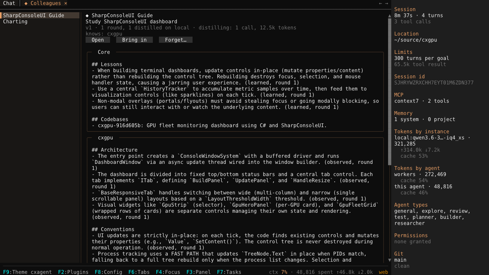
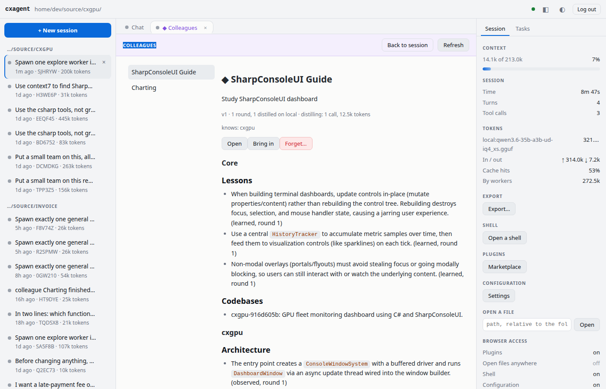

---

## A tutorial: from one codebase to the next

Everything below happened in one real run, on a local `qwen3.6-35b-a3b` served by llama.cpp. It covers two
repositories: [cxgpu](https://github.com/nickprotop/cxgpu), a GPU monitor for the terminal built on SharpConsoleUI,
and `diskdash`, an empty repository for a disk-usage dashboard that has not been started. The aim is a colleague that
learns SharpConsoleUI from cxgpu and then helps plan diskdash.

### 1. Put a worker on the codebase you know

In cxgpu, ask the agent for one:

```text
Spawn one explore worker to study how this project builds its dashboard with SharpConsoleUI:
the window and grid layout, the panels and widgets, and how they refresh. It should report a
short list with the file for each point.
```

The explorer reads the code and reports, naming a file for each point. Then ask it more, in its tab or with
`/agents send`:

```text
/agents send study-sharpconsoleui-dashboard Which control draws the braille sparkline, and how is it fed new samples?
/agents send study-sharpconsoleui-dashboard How does a tab rebuild its columns when the window is resized?
```

### 2. Keep it

A worker you have steered twice is worth keeping, and cxagent says so: one line under its answer, with **Keep** and
**Not this one**. It never waits on you; ignore it and nothing happens.

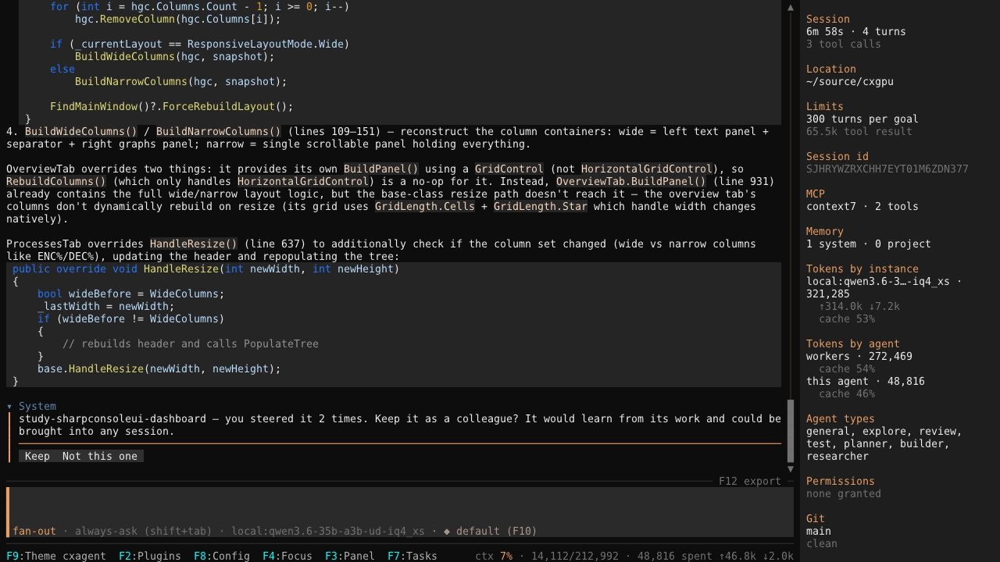

The browser offers the same, with the same buttons. Below, from later in the run, the offer is for a worker steered
twice from its view in the browser. An offer answered on either screen is gone from both.

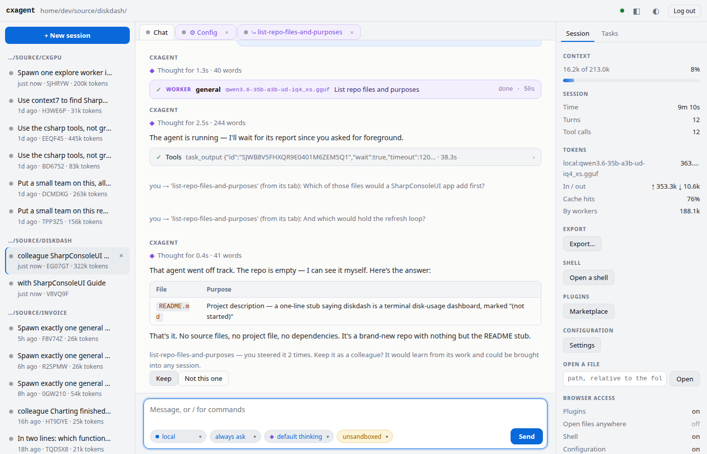

Press **Keep**, or type it yourself, with a name of your choice:

```text
/colleagues keep study-sharpconsoleui-dashboard SharpConsoleUI Guide
```

The worker is now the colleague. Its conversation so far is the first round of its past, and it is distilled into its
first experience straight away. When that finishes, the session says what it learned:

```text
Study SharpConsoleUI dashboard learned from its work: core updated, cxgpu added (v1).
```

A name taken from what the worker was doing is rarely the one you want. Rename it; its old name still finds it:

```text
/colleagues rename Study SharpConsoleUI dashboard to SharpConsoleUI Guide
```

### 3. Read what it learned

`/colleagues` opens the library, a tab in the terminal and a page in the browser. Pick the colleague to see its
experience as it was distilled. Every statement ends with how it is known and the round it comes from:

```text
- Sparkline data is accumulated in `KeyedHistoryTracker` (max 200 points per key) and fed to
  `SparklineControl` instances (using `SparklineMode.Braille`) each tick. (observed, round 1)
- Destroying and rebuilding controls on every refresh tick destroys focus and selection
  state. This forced a shift to in-place mutation in earlier versions. (learned, round 1)
```

*Observed* is what a round read or ran, as it came back. *Learned* is what it understood or inferred from that, or was
told. *Concluded* is what a round set out to check and established. The colleague is briefed to rely on concluded, to
read observed as what was seen at the time, and to check learned before it builds on it.

If a round was distilled badly — a long one boiled down to a few lines, say — distil it again, on a stronger model
if you have one:

```text
/colleagues distill SharpConsoleUI Guide on deepseek
```

### 4. Bring it into a new app

Open a session in the new repository and bring the colleague in, with a task:

```text
/sessions new ~/source/diskdash
/colleagues bring SharpConsoleUI Guide This is a new, empty repo for diskdash, a terminal disk-usage
dashboard built on SharpConsoleUI. Plan its first screen from what you know: the window, the
layout, the controls for each disk, and how they refresh without losing focus. Name the files
you would create. Plan only, write nothing.
```

A session opens by naming the colleagues it can call in. The one brought in works in the background, with a card of
its own in the **Colleagues** section of Tasks (`F7`, and the browser's Tasks pane):

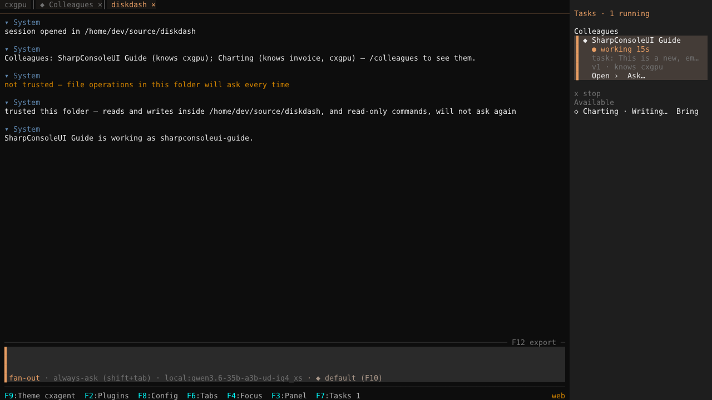

Its first move is to recall its own experience of cxgpu. Its plan is built on that: a `ConsoleWindowSystem` with a
buffered driver, `ToastService` rather than anything that steals focus, panels updated in place on each tick. Every
one of those came from the afternoon in cxgpu.


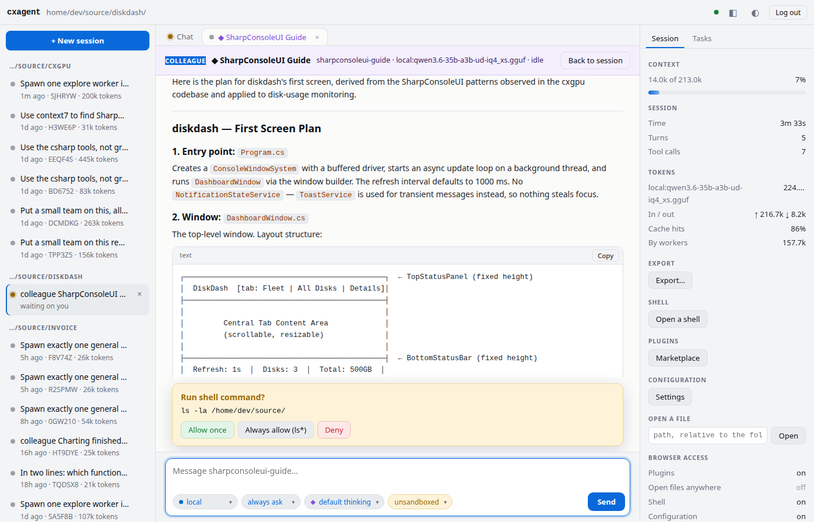

The agent you talk to can bring a colleague in too: it has a `colleague` tool, and the colleagues' names are in its
prompt. In this run the agent could not check the plan against an empty repository, so it asked the colleague to
verify it. The colleague, told to check what it had only learned, wanted to look on the web. It was denied here, from
the browser:

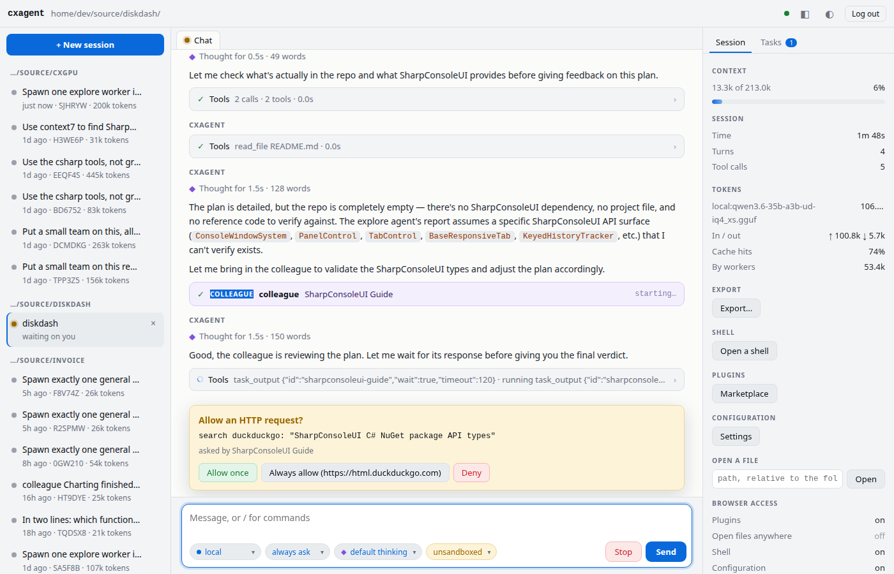

### 5. Talk with it one-to-one

`/colleagues open SharpConsoleUI Guide`, or **Open** in the library, starts a conversation with the colleague itself,
in a session of its own. It can read and recall, never write or run anything. Ask it what it knows; teach it; correct
it. Every exchange is a round and is distilled like any other. To talk with it inside the session you are working in
instead, use **Talk ›** on its card: see [How it works](#how-it-works).

```text
How should diskdash refresh its disk panels every second without losing the user's focus or
selection? Say how you know each point.
```

It answered by reading cxgpu again, its own workplace, and citing the file and line behind each point:

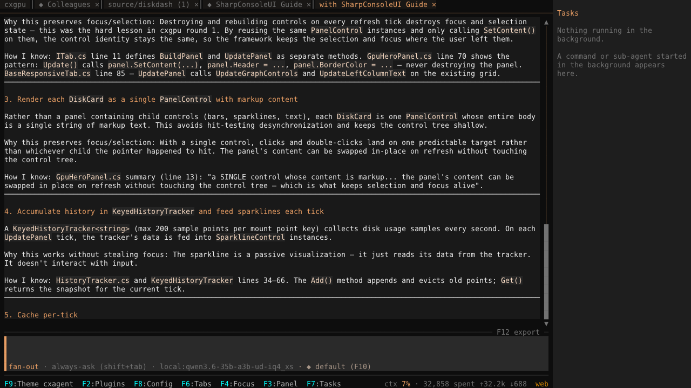
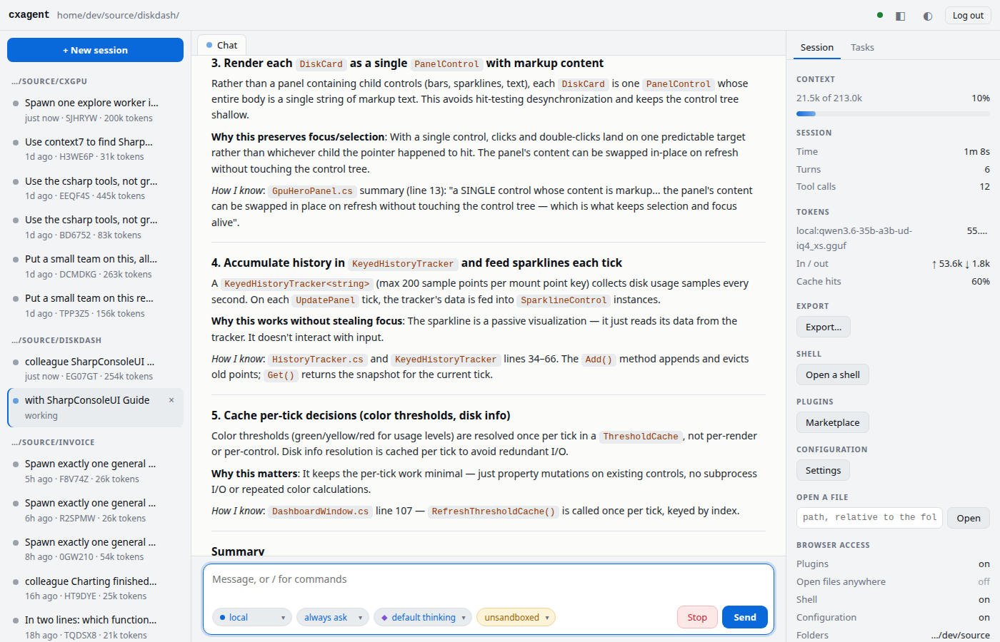

A one-to-one opens in the folder the colleague worked in last. Reading anywhere else asks first, as it did here
for cxgpu.

### 6. Freeze it when it is good

When its experience is where you want it, freeze it. It keeps working and its rounds are kept, but nothing is distilled
until you unfreeze it, and then only what it does from that moment on.

```text
/colleagues freeze SharpConsoleUI Guide
```

Or use its page in F8's **Colleagues** tab, or the browser's configuration page, the same switch in both:

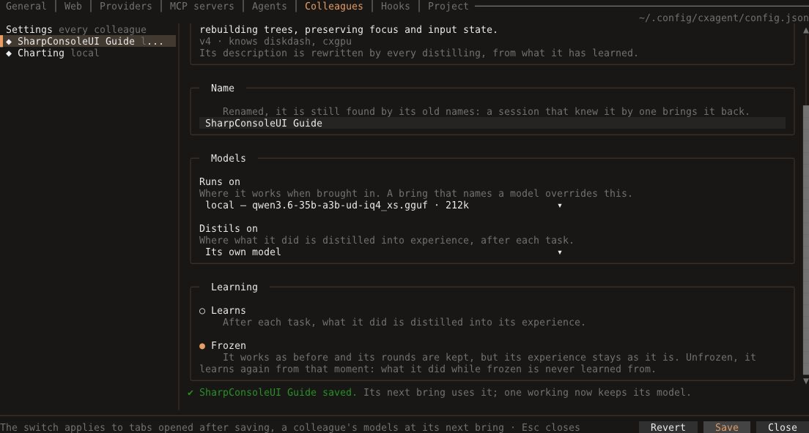
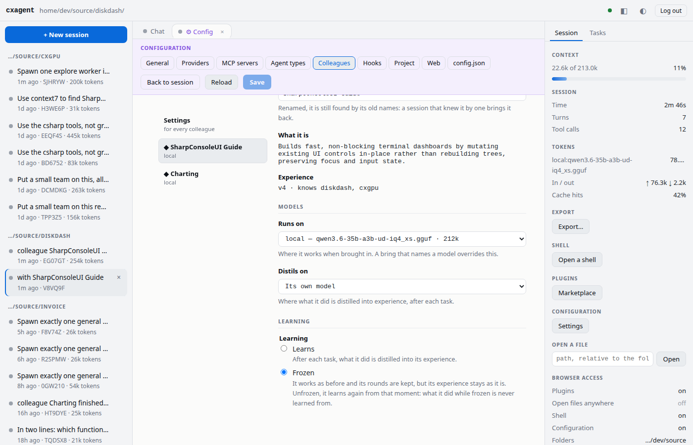

### 7. See what it costs

Distilling is a call to a model after each task. `/stats` gives it a section of its own, a row per colleague, and the
library shows each one's total:

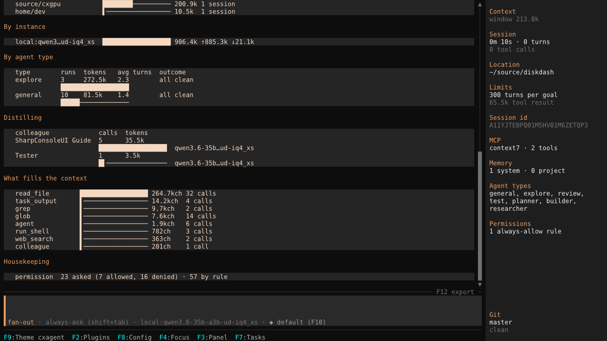
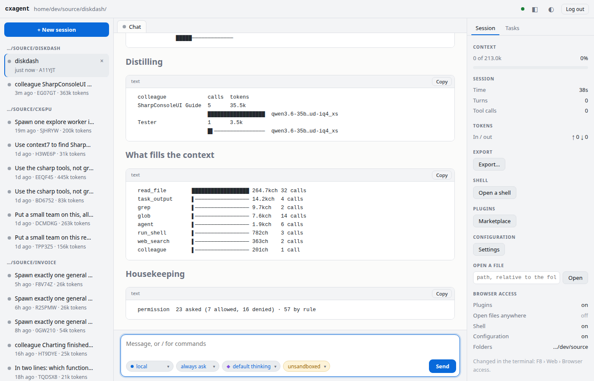

---

## Ways to use one

**A library expert you carry from app to app.** The tutorial above. Keep the worker that learned a framework in one
repository and bring it into the next one that uses it. Its codebase knowledge stays filed under the codebase it came
from, and what holds everywhere goes into its core.

**A reviewer that learns your rules.** Keep a review worker after a review you agreed with. When it flags something
your team does on purpose, tell it so in its one-to-one: *we keep the generated files in the tree; do not flag them*.
The next review starts from that.

**The one who knows a part of the project.** A colleague that has worked through the billing code several times knows
its pitfalls. Bring it in when a change touches billing:

```text
/colleagues bring Billing Is the late fee applied before or after the loyalty discount?
```

Or let the agent decide. It sees the colleagues and what each knows, and can bring one in itself:

```text
Ask the Billing colleague whether this change to the discount order breaks anything it knows about.
```

**A second opinion that does not start from zero.** Bring a colleague in idle, with no task, and give it work as the
conversation goes. It joins the session's workers, and what each ask teaches it is distilled before the next one starts.

**Someone to think aloud with.** **Talk ›** on its card opens a conversation with it beside your work, in this session:
it answers you from what it knows and keeps the thread from message to message, while the agent's asks go on apart.

```text
/colleagues bring SharpConsoleUI Guide
```

**Keeping a good state good.** Freeze a colleague before a stretch of exploratory work you do not want it to learn
from, and unfreeze it afterwards. What it did meanwhile stays in its past for recall, and never becomes experience.

---

## How it works

**The library.** `/colleagues` opens it: a tab in the terminal, a page in the browser. It lists every colleague, and
for the one picked shows its description, the folders it knows, its version, rounds and model, what distilling has
cost so far, and its experience to read. **Open** starts a one-to-one, **Bring in** brings it into the session, and
**Forget…** asks whether to forget it.

**Keeping one.** `/colleagues keep <worker> [name]` keeps one of this session's workers; typing it is your yes.
Without a name, one is taken from what the worker was doing. From then on the worker *is* the colleague: its
conversation so far is the first round of its past, and every later task it finishes is another. When the agent wants
to keep one it asks you, with **Keep** or **Don't keep**. A worker that cannot be kept, such as one that already is
a colleague, is refused without asking.

**Offered to you.** A worker gets one line under its answer offering to keep it when any of these is true:

- you steered it twice;
- the agent followed it up three times;
- it did four rounds of work here.

**Keep** keeps it under a name taken from what it was doing. **Not this one** never asks again, and that answer holds
across a resume. It comes once per worker and never waits on you. Answered in the terminal or a browser, the buttons
go from both. `colleagues.suggest` in config.json turns it off
([CONFIG.md](CONFIG.md#colleagues--workers-kept-across-sessions)).

**Bringing one in.** `/colleagues bring <name> [task]`. With a task, it starts on it in the background, and the
agent gets its report. With none, it joins **idle**, to be given work in its Ask tab or by the agent. A name with spaces
needs no quotes. A colleague already here is not brought twice: the task is passed to it.

**Every ask starts from what it has learned.** A colleague here answers each ask fresh: its conversation starts over
from its experience as the library holds it now, and nothing of an earlier ask is carried in. What it did in earlier
asks reaches it the way all its past does, through what was distilled and through `recall`. So an ask must say
everything it needs. An ask is the agent's `agent_send`, a task to one already here, `/colleagues ask <name>
[question]`, or a message in its **Ask** tab, which shows each one under a divider naming the version it started from.
A message sent while an ask runs joins that ask.

An ask waits until the colleague's earlier rounds are distilled, so it starts from all of them. Its card says *waiting
to learn* meanwhile; **Don't wait**, on the card or in the tab, starts it at once from the last finished version. A
frozen colleague never waits.

**Talking with one.** `/colleagues talk <name> [message]`, or **Talk ›** on its card, opens its **Talk** tab: a
conversation of yours with the colleague, in this session, that goes on from message to message. It is a second
worker of the same colleague, with the same experience and tools, told that it is talking with you. Each exchange is
a round and is distilled; when the experience has grown since your last message, the next one tells it the new
version. Ask and Talk run independently: the agent's asks never reach your conversation. Closing either tab keeps its
worker; the card reopens it. **New conversation** on the Talk tab, `/clear` typed there, or `/colleagues talk <name>
--new` starts the conversation over from what it has learned, under a divider naming the version. Nothing is lost:
every exchange is already distilled, so nothing asks first. A worker you kept as a colleague in this session becomes its Talk worker, since it holds
a conversation.

**Releasing one.** `/colleagues release <name>`, or **Release** on its card or in its tab, lets a colleague at rest leave
the session, its Ask and Talk workers both; the agent can release one too. Every task it finished here is already in its past, so nothing is lost,
and it can be brought again. Release is offered only while both its workers are at rest; one still working is refused:
stop it first.

**Seeing them.** A session with colleagues says so as it opens.

**Tasks** (`F7`, and the browser's Tasks pane) has a **Colleagues** section of its own, above the workers. Each
colleague here gets a card showing:

- how it stands: *answering an ask*, *talking with you*, *waiting to learn*, *queued*, *waiting for permission*,
  *learning*, *idle* or *idle · last task failed*, never finished, and *frozen* when it is;
- what it was last asked — or, while it talks with you, what you last said;
- its version and the folders it knows;
- **Ask…**, which opens its Ask tab, **Talk ›**, which opens its Talk tab, and, while it works, **Stop** — which stops
  the work the card shows, its conversation with you included — and **Background** while the agent waits on it.

Under **Available** are the library's other colleagues, each with **Bring**. The section follows the session in front.

A colleague shows no worker type anywhere: it is what it has learned. One at work is marked as a colleague wherever a
worker shows: *Colleague* on its transcript row, `◆ <name>` on its card, and `◆ <name> · ask` or `◆ <name> · talk` on its tabs.

While its experience is being distilled, the status line says *distilling <name>…*. When that ends, the session says
what it learned, such as *core updated, invoice added (v3)*, or that there was nothing new.

**One-to-one.** `/colleagues open <name>`, or **Open** in the library, starts a conversation with the colleague
itself, in a session tab of its own titled *with <name>*, in the folder it last worked in. It can read and recall,
never write or run anything. Ask it what it knows, teach it, correct it: every exchange is a round, distilled like any
other. Opening it again returns to the same conversation. It is never listed by `/sessions` or picked by `-c`.

**What it reaches.** Brought in, a colleague starts from its experience and can reach the rest:

- **Recall** searches its past for words, reads one round whole, or reads the current version of its experience — the
  newest, if it grew in another session meanwhile. A recall shows in its tab as `recall · search "…"`,
  `recall · round 9` or `recall · experience <codebase>`.
- **Workplaces**, the projects it has worked in (a folder in a git repository, or one holding a project file; a
  scratch folder like `/tmp` is not one, though what it learned there still reaches its core), it reads without asking while each is still trusted, with the file
  tools and with commands that can only look (`cat`, `grep`, `ls`). A write, a move or any other command there
  asks as anywhere else. A workplace that has moved or been deleted is named in its briefing as
  gone.
- **While the session is served to a browser**, a read in a folder that browser cannot reach asks first, and so does a
  recall of what was read there.
- **Its one-to-one** has recall too, and asks before any read outside its folder.

**How it knows what it knows.** Each statement in its experience ends with its kind and the round behind it:

- *(observed, round N)*: what a round read, ran or got back;
- *(learned, round N)*: what was understood or inferred from that, or told;
- *(concluded, round N)*: what a round set out to check and established.

A statement rises only on new evidence; recalling or repeating it never raises it. A claim that something does not
exist or cannot be done is at most learned until a round establishes it.

What no longer holds moves, so it is not learned again: under **Mistaken** when it was never true, under
**Superseded** when it held and stopped holding.

What it learns is filed where it is true: about a codebase in that codebase's part, and what holds everywhere in its
core. The round behind any statement is a recall away.

**What it learns from.** Only its own rounds: work it was given and did, and what you tell it in its one-to-one.
Another worker's output is never fed to it automatically. Showing it someone else's work is your choice, made in the
one-to-one, where you can correct it in the same conversation.

**Distilling again.** `/colleagues distill <name>`, or **Distil again…** in the library, distils its last round
again. `from round N` redoes round N and every round after it; `on <model>` runs it on another provider entry this
once, with the same 128k floor, and leaves its own distilling model as it is. It asks first, naming the rounds and
the model. What the run learns is folded into its **current** experience: a statement the earlier run got wrong
stays unless the new run replaces it, so this adds what was missed rather than undoing what was written. Rounds lived
while frozen stay unlearned, and a frozen colleague is refused until it is unfrozen. `distil` works too.

**Renaming one.** `/colleagues rename <name> to <new name>`, or its *Name* in F8's Colleagues tab or the browser's
configuration page. Its old names stay with it: a session that knew a worker by an old name still brings back this
colleague, and no other colleague can take them. Not while its one-to-one is open.

**Freezing one.** `/colleagues freeze <name>`, or *Frozen* on its page in F8's Colleagues tab or the browser's
configuration page, keeps its experience as it is. It works as before and its rounds are kept, but none is distilled.
Its card, tab and library entry say *frozen*. `/colleagues unfreeze <name>` lets it learn again **from that moment**.
What it did while frozen stays in its past for recall and is never learned from. Rounds still waiting from before the
freeze are.

**Forgetting one.** `/colleagues forget <name>`, or **Forget…** in the library, asks first. The question names:

- its past;
- its experience;
- what it learned in the folders it worked in (the folders themselves are untouched);
- how many sessions it is live in now.

On yes its folder is deleted, and its one-to-one with it. Where it is live it carries on as an ordinary worker: here
at once, in another session when its task ends. Sessions keep their own histories. Not while its one-to-one is open.

**Several sessions at once.** A colleague can work in several sessions at once. Rounds from every session are
distilled one at a time. Each ask here starts from the newest experience, whatever session it grew in; a Talk
conversation is told the new version in a line with your next message. A rename or a forget made while a colleague is being distilled waits a moment for it, and otherwise says to try
again.

**Rounds that cannot be learned from.** A round the distiller refuses three times in a row is stepped past. That can
happen when the round seems to hold a key or a password, or when the distiller's answer never fits. The round stays in
the past word for word, is not learned from, and you are told once.

**Rounds that did not finish.** A round stopped before it answered, or ended at its turn limit, is kept marked so. The
distiller reads it as what was tried, not as what worked, and recall shows the mark too.

**Models and settings.** A colleague runs on the model it was kept on, or on the session's model when that entry is not
configured here; the agent may name another model for one bring. Either must have at least a 128k window; a quarter of
that window, at most 100k, is loaded as its experience when it is brought in. A colleague already here stays on the
model it came on: a bring naming another sends it nothing, and says to release it first. F8's **Colleagues** tab, and
the Colleagues tab of the browser's configuration page, change where each one runs and where it distils, rename it and
freeze it. Under *Settings* they turn colleagues and suggestions off, as do
[`colleagues.enabled` and `colleagues.suggest`](CONFIG.md#colleagues--workers-kept-across-sessions) in config.json.

**Where they live.** Under `colleagues/` in cxagent's folder, one folder each: who it is, its experience and its past
([what is in it](CONFIG.md#what-else-lives-in-that-directory)).

---

## Commands

| Command | What it does |
|---------|--------------|
| `/colleagues` | Open the library: every colleague, what it knows, its experience |
| `/colleagues keep <worker> [name]` | Keep a worker of this session as a colleague |
| `/colleagues bring <name> [task]` | Bring a colleague in, on a task or idle to be given one |
| `/colleagues ask <name> [question]` | Ask a colleague here, fresh from what it has learned; opens its Ask tab |
| `/colleagues talk <name> [--new] [message]` | Talk with a colleague here, in a conversation that goes on; `--new` starts it over. Opens its Talk tab |
| `/colleagues release <name>` | Let a colleague at rest leave this session; it can be brought again |
| `/colleagues open <name>` | Talk with a colleague one-to-one, in a session of its own |
| `/colleagues rename <name> to <new name>` | Rename a colleague; its old names still find it |
| `/colleagues freeze <name>` · `unfreeze <name>` | Stop a colleague learning, or let it learn again from now on |
| `/colleagues distill <name> [from round N] [on <model>]` | Distil its last round again, or from a round on, after confirming |
| `/colleagues forget <name>` | Forget a colleague for good, after confirming |

The agent's `colleague` tool lists them, brings one in, keeps a worker and releases one; keeping always asks you first.
