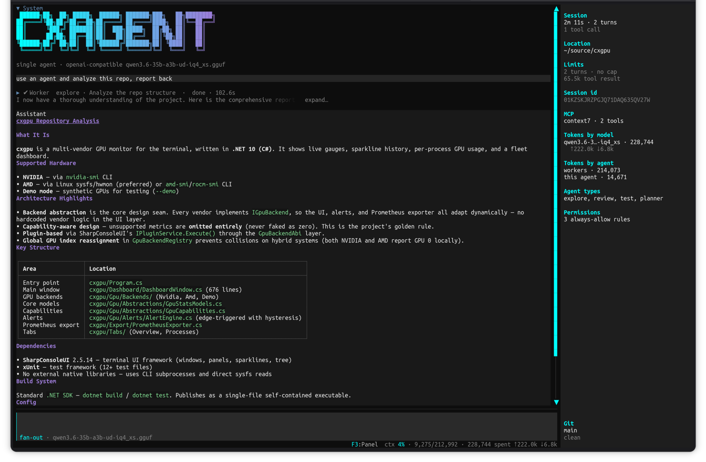

# CXAgent

<div align="center">


[](LICENSE)
[](https://www.nuget.org/packages/cxagent)
[](https://dotnet.microsoft.com/)
[]()

</div>

**[nickprotop.github.io/cxagent](https://nickprotop.github.io/cxagent/)**: install instructions, the plugin marketplace, and docs.

**A multi-agent workbench for coding, in the terminal, built on [SharpConsoleUI](https://github.com/nickprotop/ConsoleEx).**

It is not one chat loop. Several agents are alive at once, each in its own tab with its own transcript
and prompt, and sub-agents work in the background while you watch them and steer them.

Give any of them a goal in plain language. It reads your files, works out what to change, and changes
them, in one context, with the real bytes in front of it. Anything outside your working folder asks
first.

Bring your own model: Ollama, any OpenAI-compatible endpoint, or Anthropic.

<div align="center">
  
  <br>
  <sub>A worker agent explored the repo and reported back: 214,073 of the session's tokens spent
  inside the child, and 4% of the parent's context used.</sub>
</div>


## [See it working →](https://nickprotop.github.io/cxagent/)

One session closing three features in another repo, with the mistakes left in. The full walkthrough
is on the site; [`docs/screenshots/`](docs/screenshots/) has the raw captures.

## Install

Linux and macOS, no .NET required:

```bash
curl -fsSL https://raw.githubusercontent.com/nickprotop/cxagent/master/install.sh | bash
cxagent
```

Windows, the .NET tool and building from source are in [INSTALL.md](INSTALL.md). There is nothing to
configure first: the first run asks where your model runs and writes the file for you.

## Workers and sessions

Several agents at once, each in its own tab with its own history, model and permissions. The agent you
talk to puts workers on a job — an explorer, a reviewer, a tester, a planner, a builder — and they run
in the background while the conversation goes on: `F7` lists them, and a finished one keeps its context
for the next question. [USING.md](USING.md#sub-agents)

## Colleagues

Keep a worker and it becomes a colleague: after each task it is given, what it did is distilled into its
experience, and it brings that into any session you call it into. Keep the one that learned a library
in one repository and bring it into the next app that uses it. [COLLEAGUES.md](COLLEAGUES.md) has a
tutorial.

## In a browser, on your phone

`/web` serves the session you are in to a browser, and `cxagent web` serves sessions with no terminal at
all: the same turns, tabs and workers, its prompts answered from either screen. Follow a turn from your
phone and answer its permission prompt there. [USING.md](USING.md#in-a-browser)

## Models and plugins

Ollama, llama.cpp and any OpenAI-compatible server on your machine; Anthropic, OpenRouter and OpenAI in
the cloud — every feature on every one, chosen per tab and per worker. `F2` opens the plugin
marketplace; MCP servers, skills, hooks and markdown commands sit beside it.
[CONFIG.md](CONFIG.md#providers--required) · [EXTENDING.md](EXTENDING.md)

## Documentation

- [INSTALL.md](INSTALL.md) — installing, the first run, where the configuration lives, the command line, uninstalling
- [USING.md](USING.md) — what a session can do: tools, sessions, the browser, workers, keys
- [SAFETY.md](SAFETY.md) — permissions, the sandbox, and everything cxagent does to your machine
- [EXTENDING.md](EXTENDING.md) — skills, custom commands, hooks and plugins
- [COLLEAGUES.md](COLLEAGUES.md) — workers kept across sessions, with a tutorial
- [COMMANDS.md](COMMANDS.md) — every command and key
- [CONFIG.md](CONFIG.md) — every block of `config.json`
- [SCRIPTING.md](SCRIPTING.md) — `cxagent -p`: scripts, CI and other programs driving it
- [cxagent.Core](cxagent.Core/README.md) — the library under the terminal, and the plugin SDK
- [ROADMAP.md](ROADMAP.md) — what is next

## The cx family

[cxfiles](https://github.com/nickprotop/cxfiles) · [cxpost](https://github.com/nickprotop/cxpost) ·
[cxlog](https://github.com/nickprotop/cxlog) · [cxnet](https://github.com/nickprotop/cxnet) ·
[cxgpu](https://github.com/nickprotop/cxgpu) · [cxshell](https://github.com/nickprotop/cxshell)


## Star it

If cxagent is useful to you, a [star](https://github.com/nickprotop/cxagent/stargazers) helps others
find it.


## License

MIT. See [LICENSE](LICENSE).
