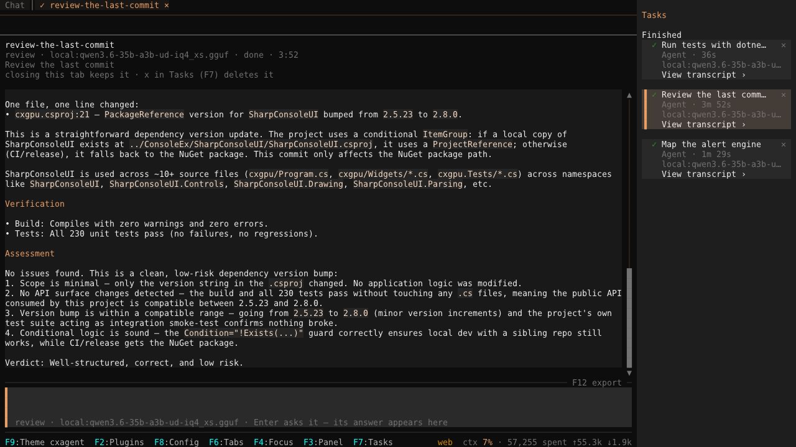
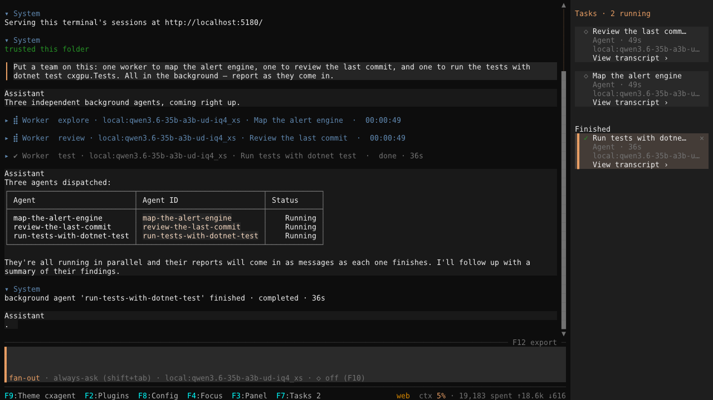
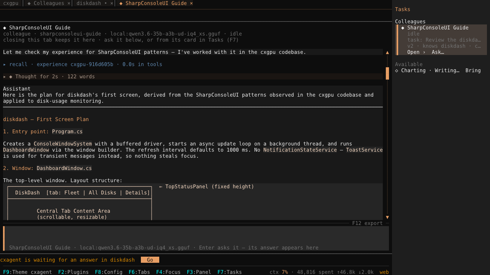
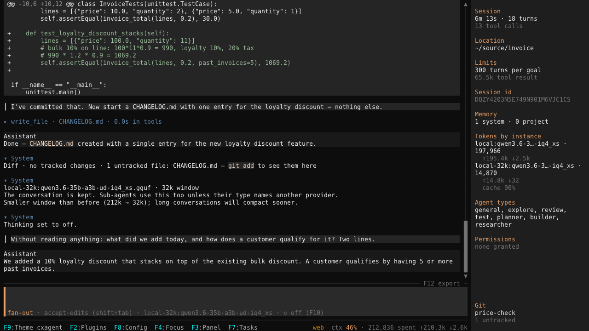
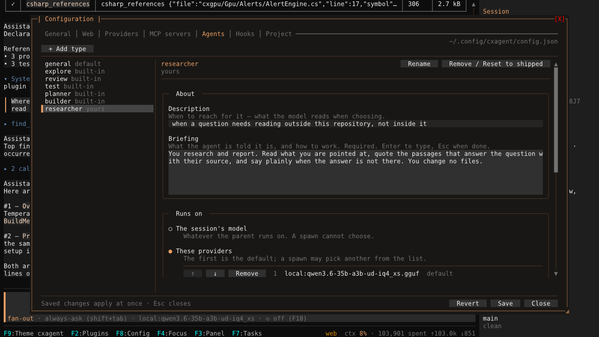
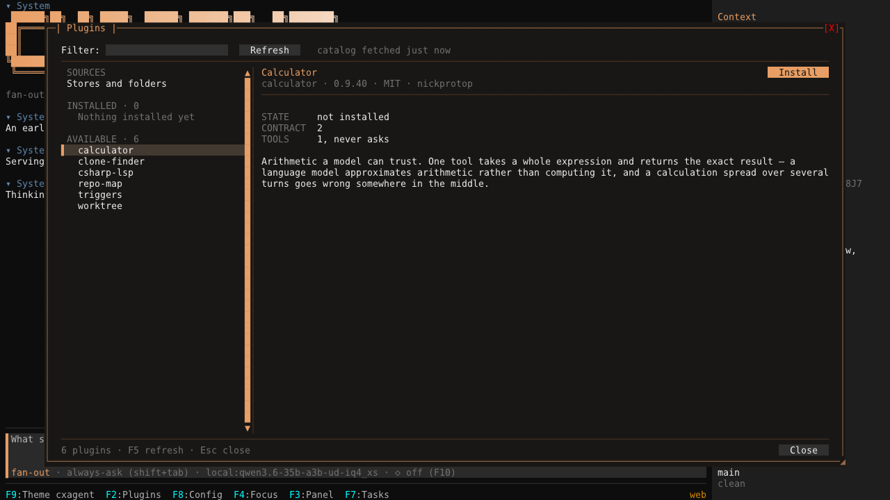
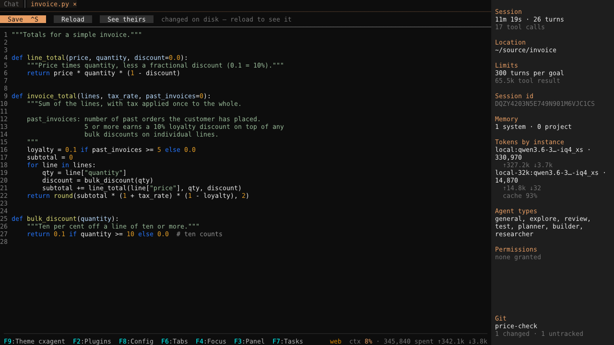
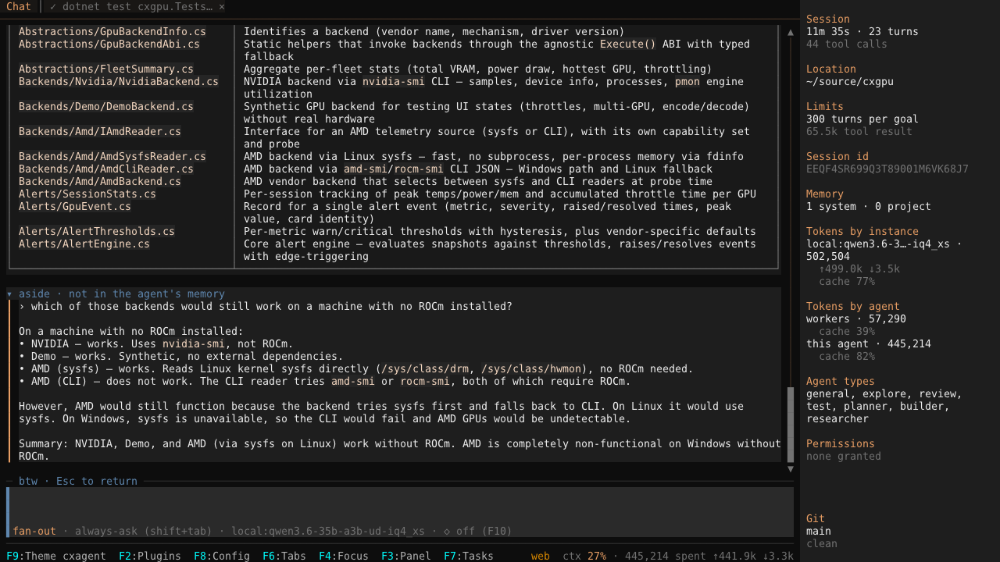
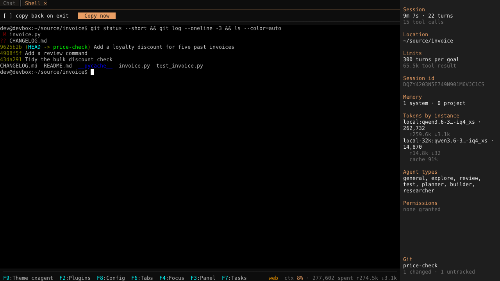
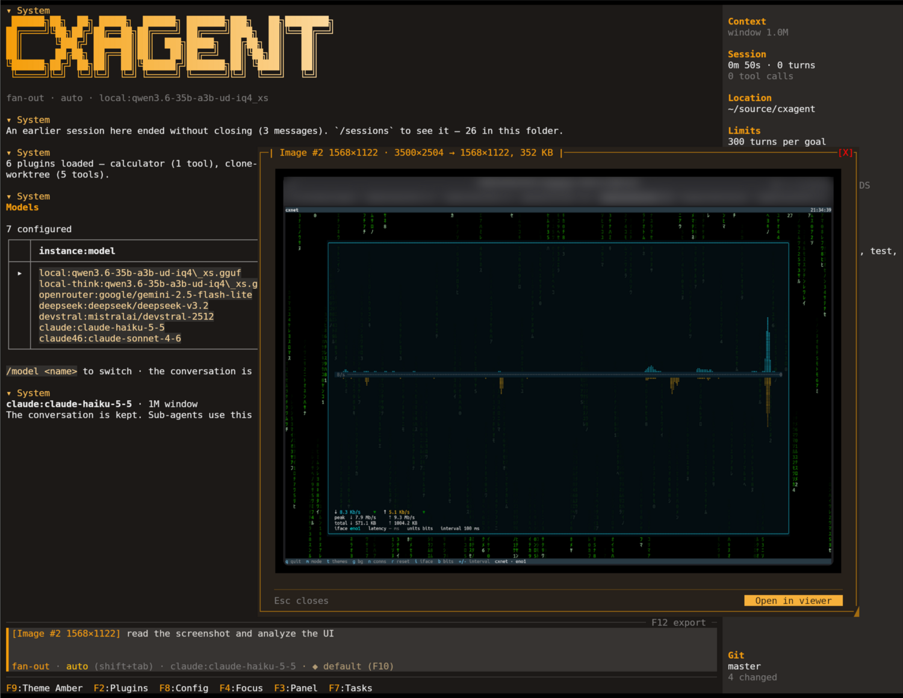

# Using cxagent

What a session can do, from the tools an agent is given to the keys you press. The commands themselves
are in [COMMANDS.md](COMMANDS.md); what keeps it in your hands is in [SAFETY.md](SAFETY.md).

## At a glance

**Several agents at once, each in its own tab.** `/sessions new [folder]` opens another conversation
in its own tab, on the same project or a different one, with its own history, model, working
directory, plugins and permissions. A sub-agent gets a tab too: `View transcript ›` on its card opens
its whole conversation, live, and the composer under it talks to that agent, not the session.
[Sessions](#sessions) has the detail.



**Sub-agents in the background, with a panel to watch and steer them.** A spawn returns at once; the
parent carries on, and each report arrives as a message when it is done. `F7` turns the right-hand
column into the tasks panel: what is running first, then a Finished section. `Enter` on one opens it
in a tab, and `x` stops a running one or deletes a finished one. `Ctrl+B` moves what the turn is
waiting on to the background mid-run. A finished sub-agent is kept, and `agent_send` asks it more on
the same conversation. [Sub-agents](#sub-agents) has the detail.



**Colleagues: workers that keep what they learned.** Keep a worker and it becomes a colleague: after
each task it is given, what it did is distilled into its experience, and it brings that into any session
you call it into. Keep the one that learned a library in one repository and bring it into the next app
that uses it. [Colleagues](COLLEAGUES.md) has the detail, and [COLLEAGUES.md](COLLEAGUES.md) a tutorial.



**A model per tab, and per sub-agent.** A `providers` entry is an instance: a name bound to one
endpoint and one model. Each tab runs on its own, and switching mid-conversation carries the
conversation across, along with a context window that follows the new model and spend that keeps
accumulating. A sub-agent type can run on a different instance than the session, and a type given a
list of them lets the spawn choose among them at the call. See [CONFIG.md](CONFIG.md) for the
`agents` block.



The Agents tab of the configuration dialog (`F8`) sets this per type: the session's model, a list of
providers whose first is the default, or any provider.



**Plugins, from a catalog.** `F2` opens the plugin manager. It lists what a catalog published on the
web offers, and downloads, verifies and unpacks a plugin into your plugins folder. Among the four in
the catalog is **triggers**: work that starts without anybody typing, where a turn schedules a prompt
to arrive later in the same session. [Plugins](EXTENDING.md#plugins) has the rest.



**An editor, in a tab beside the conversation.** `/open` puts a file in a tab: line numbers, the
language's own highlighter (TextMate grammars), no wrapping. Saving keeps the file's BOM and line
endings, and tells the model you edited it. A modified buffer is marked `•`. When the agent writes a
file you have open, a clean buffer reloads and a modified one keeps your edits and says so, with
`Reload` and `See theirs`.



**A question on the side, while the agent works.** `/btw <question>` asks without interrupting the
running turn and without adding to the conversation. A side agent that starts from what the main
agent knows answers in its own block, headed `aside · not in the agent's memory`, under the session's
permissions, and can only read. A follow-up continues its thread; the first `Esc` stops an answer, the
next one leaves.



**A real terminal, for what a tool cannot do.** `/shell` opens a PTY in a tab beside the
conversation, for a `sudo` password, `gcloud auth login` or `git rebase -i`, while the session keeps
running. Its toolbar has `copy back on exit`, off by default, and `Copy now`, which sends what the
shell has shown so far; either way it is queued and arrives with whatever you say next.



**A screenshot, pasted into the conversation.** `Ctrl+V` pastes an image from the clipboard as a token,
`[Image #1 1568×1122]`, and dropping an image file on the terminal does the same. The model is sent the
picture, shrunk to 1568 pixels on its long edge, and it stays in the context until compression. `Ctrl+G`
or a click opens it in a window of its own: Kitty draws the pixels, any other terminal draws half-blocks,
and the system viewer is a button away. A model that cannot see images is sent a short note in its
place, so the conversation carries on; the `images` key in [CONFIG.md](CONFIG.md) says which can.



**A live session panel.** The right-hand column (`F3`) shows the session as it runs: the context
window, turns and tool calls, limits, MCP servers and their tools, agent types, permissions granted,
tokens by model and by agent, and the git branch and its state. The picture at the top shows it.


## Working in a folder

Run it in the folder you want to work in, and type what you want:

```
add an overflow guard to EstimateOutputLength in HexEncoder.cs
```

It reads the file, finds the method, and edits it in place, matching the surrounding indentation
and style, because it is looking at the actual text rather than reconstructing it from memory.


## Tools

| Tool | Purpose |
|------|---------|
| `read_file` | Read a file, or a line window of it (`offset`/`limit`) |
| `write_file` | Write a whole file |
| `replace_in_file` | Replace exact passages, leaving the rest untouched; several changes to one file go in one call, applied all or nothing |
| `glob` | Find files by path pattern, e.g. `**/*.cs` |
| `grep` | Search file contents, literal or regex |
| `run_shell` | Run a command, or start one in the background (`background`) and be told when it exits |
| `http_request` | Call an HTTP endpoint |
| `web_fetch` | Read a web page as text, markup stripped |
| `web_search` | Find pages: Tavily with a key, DuckDuckGo without one (best effort); asks before each search |
| `skill` | Load a skill's instructions on demand |
| `todowrite` | Keep a task list across a long job |
| `memory` | Keep notes across sessions — system-wide, and about this project — and read them back; sub-agents read only |
| `colleague` | List colleagues — workers kept across sessions, learning from each task — bring one in, or keep a worker (asks you first) |
| `ask_user` | Ask the user questions: options with descriptions, several per call |
| `agent` | Delegate a job to a sub-agent (fan-out mode), in the background by default (`background`) |
| `agent_send` | Ask a sub-agent you already spawned for more; it still has its own context |
| `task_list` | Everything running in the background: sub-agents by handle, shell commands by pid, and what finished |
| `task_stop` | Stop a background sub-agent or command: any of them if you are the session agent, otherwise your own commands |
| `task_output` | How far a background task has got, or what it left; `wait: true` waits for it |

**A long command does not have to hold the turn.** `run_shell` with `background: true` starts the
command and returns at once with its pid and the path its output is going to (no `stdout`, because
nothing has been printed yet), and the agent is told separately when it exits, with the exit code. A
command that is *still* running at its `timeout_seconds` (120 by default) is handed over the same way
rather than killed, so the work is not thrown away and re-run; `shellDetachOnTimeout: false` in
config kills it at the deadline instead. Sixteen background commands may run at once, and past that
`background: true` is refused rather than queued. The refusal names `task_list` and `task_stop`, since
ending one is what frees a slot.

**`F7` shows this session's background commands and sub-agents in the right-hand column: running first, then a Finished section; `Enter` on one opens it in a tab, and `x` stops a running one or deletes a finished one.** **`/tasks` lists every background command and sub-agent, `/tasks stop` stops one, and `/tasks output` shows how far it has got.** The handle or pid
completes in the palette, so nothing has to be retyped from a row you just read. The model has the
same reach through `task_list`, `task_stop` and `task_output`, with one restriction a user does not
have: the session agent may stop anything, but a sub-agent may stop only its own commands, and the
refusal names who owns it.
There is no permission prompt on a kill: the command was already approved when it was backgrounded.
A detached command is killed when cxagent exits, and one left behind by a crash is killed by the next
launch.

**A long output arrives as its tail.** Above 8,192 characters `run_shell` returns the END of the
stream, plus `stdout_spill` (a file in the job's log directory holding everything the call captured,
head included) and `stdout_bytes`, the true size. The end is where a command's answer is: a failing
build's error and its summary are last, while a head would show the compiler banner. A command that
was then handed over at its deadline keeps printing to `background.out` in the same directory, so
reading all of one takes both files.

`run_shell` also takes `env`, a set of environment variables added to the command's own.

**A sub-agent runs in the background by default.** The spawn returns at once with a receipt naming
the agent; the parent carries on, and the agent's report reaches it as a message when it is done:
later in the same turn if the parent is still working, or as a new turn if it is not. A result is
delivered exactly once: if the parent asked for it with `task_output` and `wait: true`, no message
follows. `background: false` makes the spawn wait for its answer, for work the next step cannot start
without. **Ctrl+B** (twice in tmux) moves what the turn is waiting on to the background mid-run: every
foreground sub-agent and command at once, its call answered with a receipt and its report arriving later as
a background one's does. One foreground agent can be stopped alone, too: its call is answered "stopped by
the user" and the turn carries on. Escape never stops a background agent; `task_stop`, `/tasks stop`, `x` on its card in `F7`,
closing its session's tab and quitting do. Closing the agent's own tab does not, and closing or quitting asks first while one is running. A tab closes as a whole: its
background commands (its own and its sub-agents') end with it too, unless you choose "keep N commands
running" when it asks, for a server or a watcher meant to outlive the tab. An agent the user stopped reports
that it was stopped, and the model is refused if it tries to restart it; the user's own `/agents send`,
or a line typed in the agent's tab, is the way back. Once it has finished, `x` on its card deletes it:
gone from the panel, `/tasks`, `/agents open` and the model's reach, after any report it still owed the
model has been handed over. If commands it started are still running, it asks first whether to stop them
or keep them running. Headless runs (`-p`) spawn in the foreground, since a run with one answer has to wait
for the work that answer needs.

**A sub-agent is kept, not thrown away.** When one finishes, its context (everything it read, ran
and concluded) stays for the life of the session, and `agent_send` asks it more on that same
conversation. That is far cheaper than spawning a second agent to cover the ground the first already
covered, which would have to redo the work to get back to where the first one already was. `agent`
and `agent_send` are offered only to an agent that can spawn, so a sub-agent cannot reach a sibling.

**One name per tool, and no aliases.** Several of these have been renamed: `glob` was
`list_files`, `grep` was `search_files`, `agent` was `spawn_agent` then `task`, `ask_user` was
`question`. Each old name was accepted for a short window afterwards so a conversation resumed across
the change would not fail on a name it had seen in its own history. Those windows are closed: a call
under an old name gets `no such tool`, with the current names listed beside it.

`todowrite` keeps its unusual spelling deliberately: it is what Claude Code calls it, and models
distilled from it recognise the exact string.


## Sessions

**One window holds several conversations.** `/sessions new [folder]` opens another in its own tab,
on the same project or a different one. Each is a whole session end to end: its own history, model,
working directory, plugins and permissions.

That last part is the one worth stating plainly. **A permission answered in one session has not been
answered for the others**, a plugin unwired in one keeps running in the rest, and a turn stopped in
one leaves the others alone. Two conversations in one window are two conversations, not one
conversation with two views.

`F6` focuses the tab strip, `←` and `→` change tabs, `F6` returns to the composer. A tab whose
session is waiting on a permission prompt says so, so a session that needs you cannot sit quietly
behind the one you are reading.

**`/btw <question>` asks a side question without adding it to the conversation.** A side agent that
starts from what the main agent knows answers in its own block, under this session's permissions, and
can only read. Enter keeps the side thread going; `Esc` stops an answer, then leaves. See
[COMMANDS.md](COMMANDS.md#btw).

**A conversation comes back whole.** `cxagent -c`, `/sessions resume` and a session opened in a
browser all draw its whole past again — every turn, tool call and worker, back through earlier
resumes — and bring its workers back, so the model can carry on with them. See
[COMMANDS.md](COMMANDS.md#sessions).

**Any conversation exports as markdown.** `F12` or `/export` writes this one (readable for a person, or full
for another agent to continue from) to a file or the clipboard, as a timeline with each sub-agent's work where it
happened. `/sessions export` does the same for an earlier session from any folder, without resuming it. See
[COMMANDS.md](COMMANDS.md#export).

**You see what the model thinks, and choose how hard.** Each step's thinking is its own block, folded
from the start (`◆ Thought for 9s · 412 words` once it is done), from a local
llama.cpp model or from Claude. `Ctrl+O` opens or folds the latest; any other opens with a click. `/think` and `F10` set the level the
model offers (`off`/`on` on llama.cpp, `low` to `max` on Claude, a model's own efforts on OpenRouter) for this session, kept on resume.
See [COMMANDS.md](COMMANDS.md#think) and [CONFIG.md](CONFIG.md#providers--required).


## In a browser

`cxagent web` serves your sessions to a browser, with no terminal. Inside the terminal, `/web` serves
the sessions it already has, so you can follow them and answer their prompts from a phone. One page
fits the screen it is on: on a desktop a session list beside the chat, with the session's own tabs —
its chat, then the workers, colleagues, commands and pages opened from it — above it; tabs for every
open view on a tablet; and on a phone a list with what is waiting on you at the top, then the chat full
screen.

```bash
cxagent web                       # http://localhost:5180, this machine only
cxagent web passwd me             # store a hashed password in config.json
cxagent web --bind 0.0.0.0 --self-signed   # reachable from the LAN, over HTTPS
cxagent --web                     # the terminal, and its sessions in a browser as well
cxagent web --daemon              # in the background: prints where, and returns
cxagent web status                # is one running, where, since when
cxagent web stop                  # stop it as Ctrl+C would: running turns cancelled and saved
```

It starts on a short summary: every address it can be reached at — the machine's network addresses
too when it listens on `0.0.0.0` — who must log in, the folders it opens, the model, and the browser
access switches. One server runs per config folder; `--daemon` writes its output to `web.log` there.

The page draws a turn as the terminal does: markdown with highlighted code, each round of tool calls
folded into a row you can open, and each worker as a card that opens its own tab with its own
transcript. A side panel shows the session (context, turns, tokens, folder) and its tasks, with
workers and background commands you can open or stop. The model, the edit mode, the thinking level
and the sandbox are chosen under the message box.

**The terminal's tabs, in the browser.** `/btw` side questions, pasted and dropped images, an export
as markdown, a background command's output in a tab, the editor (`/open`), and the terminal's
listings. Four things that reach further each wait on a switch only the terminal turns on — F8 › Web
› Browser access, or `web.allow`: the plugin marketplace (on by default), the editor beyond
`web.roots`, a real shell in a tab, and the configuration page with F8's tabs as forms (off). A
browser never changes those switches, the users or the folders.
[COMMANDS.md](COMMANDS.md#web) has the whole list.

**A login is a shell on this machine.** Whoever gets in drives an agent that runs commands here,
contained only as far as the sandbox contains them. So the server listens on localhost unless told
otherwise, a login is required as soon as it listens anywhere else, and it refuses to start that way
with no `web.users` set. A browser opens sessions only under `web.roots` (the folder it started in, by
default), and a folder's trust, the permission rules and the sandbox apply exactly as in the terminal.

**Prompts go to everyone looking.** A permission prompt, a trust question or the model's own question
shows in the terminal and in every browser tab on that session, and the first answer wins. Under
`/web`, a session the browser starts or resumes opens as a tab in the terminal too.

**One process per session.** A session open in one place cannot be opened in another: the terminal and
the browser both say where it is open. `cxagent web` stops on Ctrl+C or SIGTERM, cancelling and saving
running turns the way closing the terminal does.

**HTTPS.** `--self-signed` makes a certificate once and keeps it, so a browser's warning is accepted
once. For a real certificate, put nginx, Caddy or Tailscale in front, and set `web.login` to `always`:
behind a proxy every request comes from localhost, which `auto` would let in without a login. See
[CONFIG.md](CONFIG.md#web--the-browser-front-end).


## Sub-agents

**Fan-out is the default.** The agent can delegate a job to a sub-agent: a second agent with its own
context, its own conversation, and its own compaction. It runs, returns one message, and stops.

What that buys is room. A search that reads thirty files to answer one question fills a context with
material nobody needs afterwards. Delegated, the parent keeps the conclusion and not the file dumps.
Measured on a real repo: 23k characters in the parent instead of 213k, for the same answer.

A sub-agent's work is not shown in the transcript. It gets one row, showing live turns, context
occupancy and elapsed time; expand it to see what the child is doing, or its report once it has
finished.

`/mode agent single` turns delegation off for a session, `/mode agent fan-out` turns it back on, and
`--mode single` starts that way. Single mode's prompt is what shipped before sub-agents existed:
turning it off really does turn it off.

The axis is named because there is more than one, and `/mode` on its own reports every axis rather
than guessing which one you meant.

**`/mode edits`** decides when a file write happens without asking. `always-ask`, the default,
prompts for every one; `accept-edits` keeps writes inside the working directory silent and asks
everywhere else. **Shift+Tab cycles it** from the composer, and the choice is remembered for the
folder. It cannot widen past your trust decision: on a folder you did not trust,
`accept-edits` still asks for everything, and the listing says so. Writes to `.git/`, `.vscode/`,
`.claude/`, `.idea/`, `.github/`, `.husky/`, `.devcontainer/`, `.cxagent/` and an `.envrc` keep asking regardless. A
hook that runs on your next git command is not what anyone means by "accept edits".

**Named types** say how a delegated job should be done. **Five ship with cxagent** and need no
configuration, including a **planner** that writes a plan to `./plans/` and reports what it decided,
and a **builder** that implements one and refuses to start without it. Their briefings live in the
program rather than in your config file, because a briefing is the contract a type keeps with the code
around it: cxagent names the file a planner must write, checks afterwards whether it is there, and the
builder refuses work that arrives without one. Config still chooses where a type runs (`provider`) and what
it may spend (`maxTurns`), and any name cxagent does not ship is entirely yours, briefing and all.
See [CONFIG.md](CONFIG.md) for the `agents` block, and [COMMANDS.md](COMMANDS.md) for `/mode` and
`/stats`.

**Honest about the limits**, because they are the sort you would otherwise find out the hard way:

- **Delegation depends on your model, and what we measured is one model.** On a local
  `qwen3.6-35b-a3b`, it delegates readily when asked (say "use a sub-agent to…" and it will) and
  rarely on its own judgement, usually doing the work inline instead. A stronger model may well
  choose to delegate unprompted; we have not measured one. Treat the guidance as a starting point
  rather than a property of the tool.
- **Sub-agents in one message run concurrently.** In the background each reports on its own as it
  finishes; with `background: false` the parent waits for all of them before it answers.
- A sub-agent cannot spawn its own: not a rule it is asked to follow, a tool it is never given.
- **A briefing is a request, not a permission.** "Never edit files" in a type's briefing asks the
  agent not to; it does not remove the tool. Permissions are the mechanism that constrains an agent,
  and they apply to sub-agents exactly as they apply to the main one.


## Keys

| Key | Action |
|-----|--------|
| `Enter` | Send. During a running turn, queues instead; several queued messages go as one prompt |
| `Esc` | Stop the running turn. Anything queued goes back into the composer rather than being lost. In btw mode: stop the aside's answer, then leave btw mode |
| `F1` | Help |
| `F3` | Session panel (show / hide / automatic) |
| `F4` | Put the cursor back in the composer |
| `F6` | Focus the tab strip, then `←` `→` to change session, `F6` back to the composer |
| `Ctrl+B` | Move what the turn is waiting on to the background: every foreground sub-agent and command (twice in tmux) |
| `F7` | Tasks panel: background commands and sub-agents in the right-hand column; `↑` `↓` choose, `Enter` opens, `x` stops a running one and deletes a finished one. `F7` again hides it |
| `F8` | Configuration: general settings, providers, MCP servers, agent types |
| `F12` | Export this conversation as markdown, readable or full, to a file or the clipboard; in an agent's tab, that agent. See [`/export`](COMMANDS.md#export) |
| `F10` | Next thinking level this model offers; see `/think`. (gnome-terminal opens its own menu on F10 unless that is turned off in its preferences) |
| `F9` | Theme |
| `Ctrl+O` | Open or fold the latest thinking block |
| `Ctrl+G` | Expand the pasted text beside the caret, or show the image. A paste of three lines or more, or 800 characters, sits in the composer as one token, `[Pasted text #1 +18 lines]`; the model is sent the text, and a click on the token expands it too |
| `Ctrl+V` | Paste an image from the clipboard as a token, `[Image #1 1568×882]` (`Alt+V` on Windows); when the clipboard holds text, the text is pasted. Dropping an image file on the terminal does the same. The model is sent the image, shrunk to 1568 pixels on its long edge (a large photo goes as a JPEG), and a model that cannot see images is told so instead |
| `Shift+Tab` | Cycle the edit mode; see [COMMANDS.md](COMMANDS.md) |
| `Ctrl+Q` | Quit |

Commands are typed in the composer; see [COMMANDS.md](COMMANDS.md).
