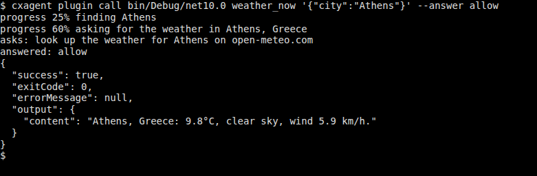
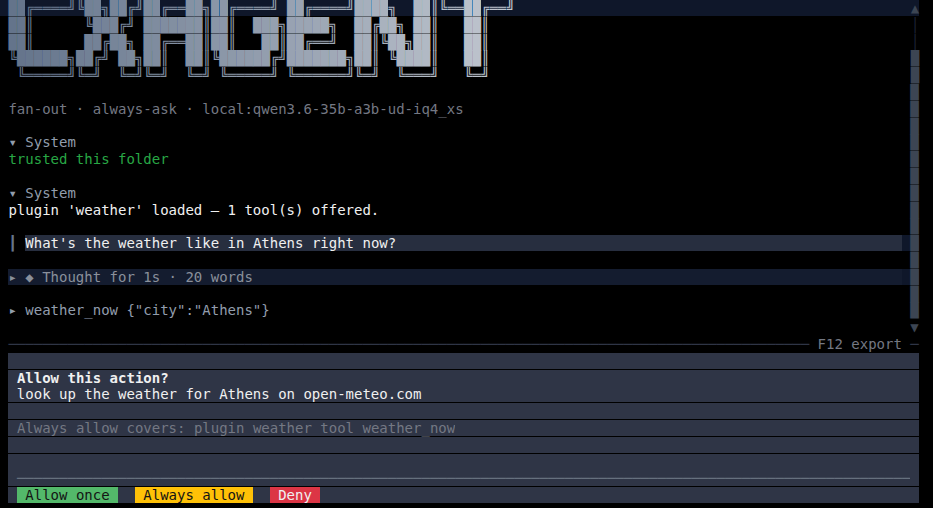
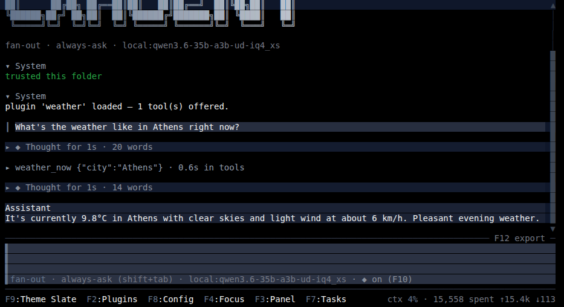

# The cxagent plugin SDK

Everything an author outside this repository needs to write, test and ship a cxagent plugin:

| Folder | What it is |
|---|---|
| [`templates/`](templates) | The C# plugin template, used by both `cxagent plugin new` and `dotnet new cxagent-plugin` (package **CxAgent.Plugins.Templates**) |
| [`testing/`](testing) | **CxAgent.Plugins.Testing**: check and call a plugin from xunit, NUnit or MSTest |
| [`c/`](c) | `cxagent_plugin.h`, the C ABI. A full C SDK is coming |

The command-line half is in cxagent itself: `cxagent plugin new | check | call | pack | verify`.

The reference is [docs/plugins.md](../docs/plugins.md), with testing covered in
[docs/plugin-testing.md](../docs/plugin-testing.md). This page is the tutorial.

## Tutorial: a weather plugin, end to end

We build `weather`, one tool that tells the model the current weather in a city. It uses
[Open-Meteo](https://open-meteo.com), which is free and needs no key. Along the way the plugin asks
the user before every lookup, reports progress while it works, is tested, and is packed for others
to install.

You need the .NET 10 SDK and cxagent:

```
dotnet tool install -g cxagent
```

### 1. Start from the template

```
cxagent plugin new weather --lang csharp
cd weather
```

Or `dotnet new install CxAgent.Plugins.Templates` then `dotnet new cxagent-plugin -n weather`: both
give the same project.

```
weather/
  weather.csproj          the plugin, a net10.0 library
  weather.plugin.json     the sidecar: what the plugin offers, read before any of its code runs
  Plugin.cs               the code
  README.md               what a user reads in cxagent's plugin manager
  tests/                  xunit tests through CxAgent.Plugins.Testing
```

It builds and runs as it stands: `dotnet build`, then
`cxagent plugin call bin/Debug/net10.0 weather_greet '{"name":"Ada"}'`. Now make it a weather
plugin.

### 2. Say what it offers: the sidecar

Replace `weather.plugin.json`:

```json
{
  "pluginContract": 4,
  "kind": "managed",
  "name": "weather",
  "version": "1.0.0",
  "spawns": false,
  "instructions": "weather_now gives the current weather for a city. Use it whenever the user asks what the weather is like somewhere.",
  "tools": [
    {
      "name": "weather_now",
      "description": "The current temperature, conditions and wind for a city, from Open-Meteo.",
      "inputSchema": {
        "type": "object",
        "properties": { "city": { "type": "string", "description": "The city, e.g. Athens." } },
        "required": ["city"]
      },
      "gated": "dynamic"
    }
  ]
}
```

The sidecar is the **one copy** of the manifest:
- cxagent shows it to the user before loading anything;
- `Load` returns it unchanged (`PluginManifest.FromSidecar`);
- `"gated": "dynamic"` means the plugin decides per call whether to ask, and with what words.

### 3. Write the tool

Replace `Plugin.cs`:

```csharp
using System.Text.Json;
using CxAgent.Core.Jobs;
using CxAgent.Core.Models;
using CxAgent.Core.Plugins;

namespace weather;

/// <summary>The current weather for a city, from Open-Meteo — free, and no API key.</summary>
public sealed class Plugin : IPlugin, IPluginGateSource
{
    private static readonly HttpClient Http = new() { Timeout = TimeSpan.FromSeconds(15) };

    public Task<PluginManifest> Load(IPluginContext context, CancellationToken ct) =>
        Task.FromResult(PluginManifest.FromSidecar(this));

    public Task Start(CancellationToken ct) => Task.CompletedTask;

    // The call leaves the machine, so the user is asked — naming the city, so they know what is sent.
    public PluginGate? Gate(string toolName, JobParameters call) =>
        new PluginGate($"look up the weather for {call.Get<string>("city")} on open-meteo.com");

    public async Task<JobResult> Invoke(string toolName, JobParameters call, IJobContext context, CancellationToken ct)
    {
        var city = call.Get<string>("city");
        if (string.IsNullOrWhiteSpace(city))
            return new JobResult { Success = false, ErrorMessage = "pass a city." };

        context.ReportProgress(25, $"finding {city}");
        using var places = JsonDocument.Parse(await Http.GetStringAsync(
            $"https://geocoding-api.open-meteo.com/v1/search?count=1&name={Uri.EscapeDataString(city)}", ct));
        if (!places.RootElement.TryGetProperty("results", out var results) || results.GetArrayLength() == 0)
            return new JobResult { Success = false, ErrorMessage = $"no place called '{city}'." };

        var place = results[0];
        var name = $"{place.GetProperty("name").GetString()}, {place.GetProperty("country").GetString()}";
        context.ReportProgress(60, $"asking for the weather in {name}");

        using var forecast = JsonDocument.Parse(await Http.GetStringAsync(
            "https://api.open-meteo.com/v1/forecast?current=temperature_2m,weather_code,wind_speed_10m"
            + $"&latitude={place.GetProperty("latitude").GetDouble()}&longitude={place.GetProperty("longitude").GetDouble()}", ct));
        var now = forecast.RootElement.GetProperty("current");
        var text = $"{name}: {now.GetProperty("temperature_2m").GetDouble()}°C, "
                 + $"{Describe(now.GetProperty("weather_code").GetInt32())}, "
                 + $"wind {now.GetProperty("wind_speed_10m").GetDouble()} km/h.";

        // "content" is what the model reads; give it a sentence it can repeat.
        return new JobResult { Success = true, Output = { ["content"] = text } };
    }

    public Task Stop(CancellationToken ct) => Task.CompletedTask;

    // WMO weather codes, as Open-Meteo reports them, grouped.
    private static string Describe(int code) => code switch
    {
        0 => "clear sky",
        1 or 2 or 3 => "partly cloudy",
        45 or 48 => "fog",
        >= 51 and <= 67 => "rain",
        >= 71 and <= 77 => "snow",
        >= 80 and <= 82 => "showers",
        >= 95 => "thunderstorm",
        _ => "mixed conditions",
    };
}
```

A failure is a result, not an exception: `Success = false` with a message the model can act on.
`ReportProgress` shows on the call's row while it runs.

### 4. Check it and call it, with no session

```
dotnet build
cxagent plugin check bin/Debug/net10.0
```

`check` runs every test cxagent makes at load time — the sidecar, the contract, the names, the
code's manifest against the sidecar — and prints `ok` or every problem, one per line.

```
$ cxagent plugin call bin/Debug/net10.0 weather_now '{"city":"Athens"}'
asks: look up the weather for Athens on open-meteo.com
stopped: a user would be asked — pass --answer allow or --answer deny

$ cxagent plugin call bin/Debug/net10.0 weather_now '{"city":"Athens"}' --answer allow
progress 25% finding Athens
progress 60% asking for the weather in Athens, Greece
asks: look up the weather for Athens on open-meteo.com
answered: allow
{
  "success": true,
  ...
  "output": {
    "content": "Athens, Greece: 9.8°C, clear sky, wind 5.9 km/h."
  }
}
```

`call` runs the real lifecycle once: Load, Start, the permission question, Invoke, Stop. It does so
without a model, so you see exactly what your code does:



### 5. Test it

Replace `tests/PluginTests.cs`:

```csharp
using CxAgent.Plugins.Testing;
using Xunit;

public class PluginTests
{
    private static readonly string PluginFolder = Path.GetFullPath(Path.Combine(
        AppContext.BaseDirectory, "..", "..", "..", "..", "bin", "Debug", "net10.0"));

    [Fact]
    public async Task ItLoads() => Assert.Empty(await PluginHarness.CheckAsync(PluginFolder));

    [Fact]
    public async Task ItAsks_NamingTheCity()
    {
        await using var plugin = await PluginHarness.LoadAsync(PluginFolder);

        var call = await plugin.CallAsync("weather_now", new { city = "Athens" });

        Assert.Equal("look up the weather for Athens on open-meteo.com", call.Gate!.Display);
        Assert.True(call.StoppedAtGate);
    }

    [Fact]
    public async Task Allowed_ItAnswersForThePlace()
    {
        await using var plugin = await PluginHarness.LoadAsync(PluginFolder);

        var call = await plugin.CallAsync("weather_now", new { city = "Athens" }, answer: GateAnswer.Allow);

        Assert.True(call.Result!.Success, call.Result.ErrorMessage);
        Assert.StartsWith("Athens, Greece:", (string)call.Result.Output["content"]!);
        Assert.Contains(call.Progress, p => p.Percent == 60);
    }
}
```

```
dotnet test tests
```

The harness is the same code as `check` and `call`. It loads the plugin the way a session does and
asks the same question a session would.

### 6. Use it yourself

Copy the build into cxagent's plugins folder, one folder per plugin:

```
mkdir -p ~/.config/cxagent/plugins/weather
cp bin/Debug/net10.0/weather.dll bin/Debug/net10.0/weather.plugin.json README.md ~/.config/cxagent/plugins/weather/
```

Then, in cxagent, run `/plugin load weather.dll` and ask *"what's the weather in Athens?"*. You are
asked once, with the sidecar's summary, whether to load the plugin. Then the model calls
`weather_now`, and you are asked about Athens before anything leaves the machine. To load it at
every start, add it with `/plugin browse`, or in `config.json`:

```json
"plugins": { "weather": { "file": "weather.dll", "enabled": true } }
```

The plugin's own question, in the words `Gate` returned:



And the model's answer, built from the tool's `content`:



In an asking mode, cxagent first asks once whether to use the tool at all ("use the weather_now tool
in this folder"). That question is cxagent's, and the same for every tool. The one above is your
plugin's.

### 7. Pack it for others

Say what it is in `weather.csproj`, or with `--description`, `--publisher`, `--license` and
`--repository`, or in a JSON or YAML file passed as `--info`. The template leaves the description
and the license empty on purpose, because they are yours to choose:

```xml
<Description>The current weather for any city, from Open-Meteo.</Description>
<Authors>you</Authors>
<PackageLicenseExpression>MIT</PackageLicenseExpression>
<RepositoryUrl>https://github.com/you/weather</RepositoryUrl>
```

```
dotnet build -c Release
cxagent plugin pack bin/Release/net10.0 --out dist
```

`pack` refuses a plugin `check` refuses. Otherwise it writes:
- `dist/weather.zip`, holding what a release ships: the dll, the sidecar and the README;
- its sha256;
- `dist/weather.catalog.json`, the catalog entry;
- the steps that are left.

### 8. Verify, then publish

Before uploading, point the entry's `"url"` at the zip on disk. A relative path resolves from the
entry file's folder, so `"url": "weather.zip"` works here. Then:

```
cxagent plugin verify dist/weather.catalog.json
```

`verify` does what a user's install does, without running any of your code:
- downloads the zip;
- checks its sha256;
- unpacks it;
- holds the sidecar against every field the entry claims.

Then follow `pack`'s next steps:
1. Upload the zip (for example, `gh release create v1.0.0 dist/weather.zip`).
2. Put its `https://` URL in the entry and run `verify` once more.
3. Submit the entry, through the "Submit a plugin" issue or as a PR to `plugins/plugins.json`.

## Where to go next

- **The rest of the contract** is in [docs/plugins.md](../docs/plugins.md): settings, commands,
  spawning processes, starting turns from a plugin, and reporting while a call runs.
- **Every option of `check`, `call` and the test package** is in
  [docs/plugin-testing.md](../docs/plugin-testing.md).
- **Two complete examples** sit beside this folder, the same calculator in C# and in C:
  [`examples/CalculatorPlugin`](../examples/CalculatorPlugin) and
  [`examples/CalculatorAbiPlugin`](../examples/CalculatorAbiPlugin).
