# cxagent, in use

Real sessions, driven by a local `qwen3.6-35b-a3b`. Most are one run at
[cxlog](https://github.com/nickprotop/cxlog) — closing three unfinished features by wiring
`--follow`, `--export` and `--session` to services that already existed, then running the binary it
had just built.

Nothing here is staged. The mistakes are in the pictures too, because they are what the runs
actually did.

---

## Trusting a folder

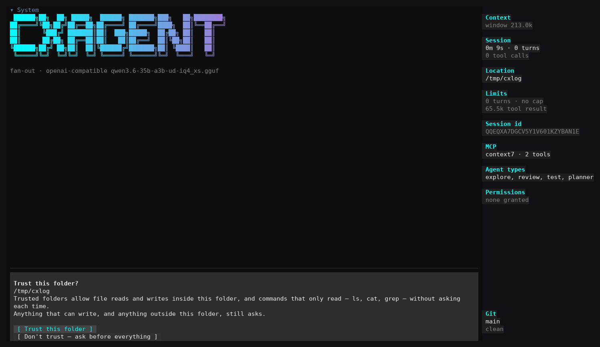

The first question of the first session. Reads and writes inside this folder stop asking; anything
that writes elsewhere, and every shell command, still stops.

---

## Sub-agents

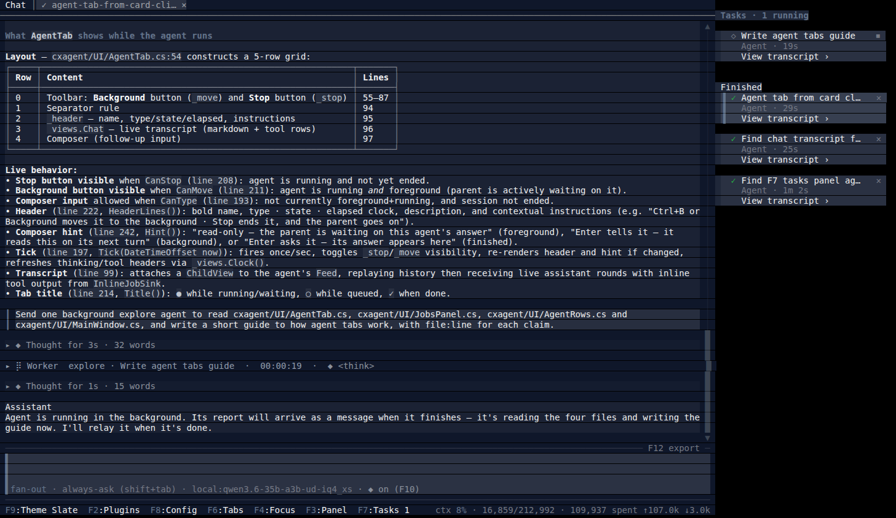

This repository, asked to send explore agents to find how its own agent tabs work. A sub-agent runs in
the background by default: the spawn answers at once, the conversation carries on, and each report
arrives as a message when it is done — here the one above, a table of `file:line` for every part of
the tab. `F7` turns the right-hand column into the tasks panel: what is running first, with its clock
and a `⏹`, then a Finished section.

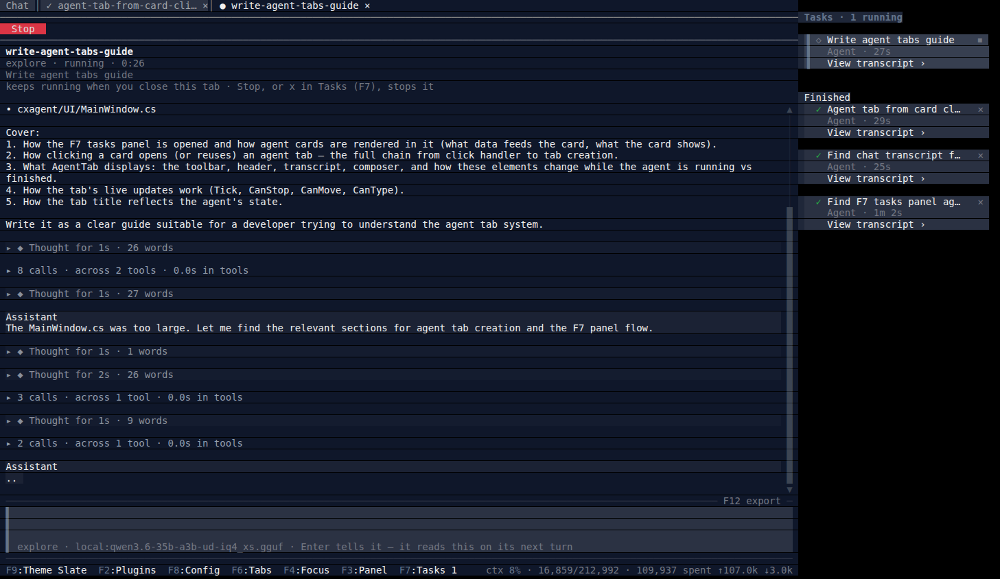

`View transcript ›` on a card opens that agent in a tab of its own. It is the agent's whole
conversation, live: the brief it was given, each step's thinking folded between its tool calls, and
its answer as it is written. `Stop` ends it; a foreground one also gets `Background`, which hands it
off so the parent's turn goes on — the same as `Ctrl+B`. The composer under it talks to the agent, not
the session: "Enter tells it — it reads this on its next turn". Closing the tab leaves the agent
running.

---

## Stopping without losing what you typed

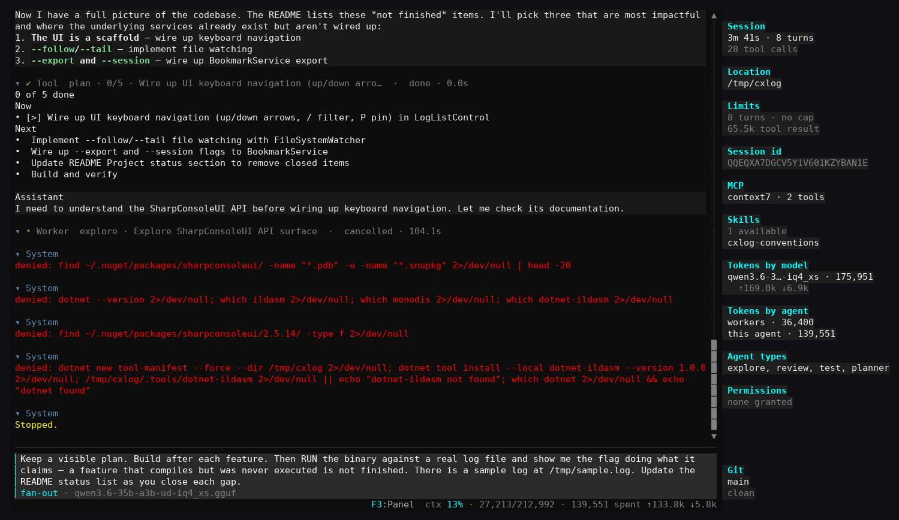

Escape ends the turn. Anything queued goes back into the composer rather than being discarded — it
was never sent, so stopping must not eat it.

---

## Asking the user

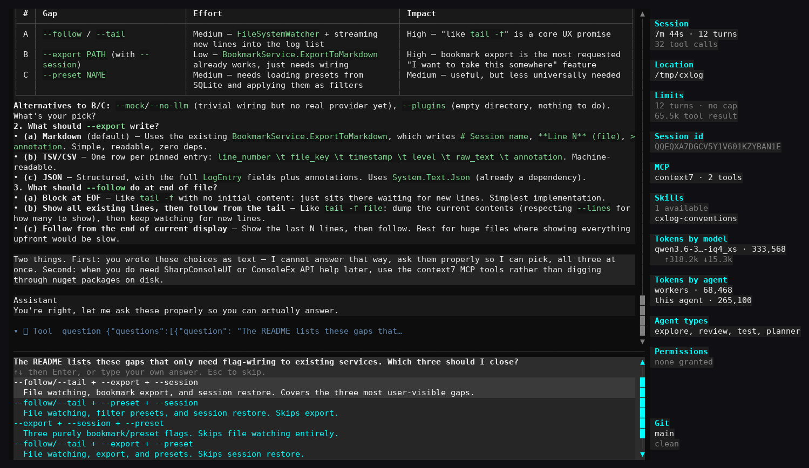

The model needed three decisions that were mine to make. It gets one call, up to four questions,
presented as steps.

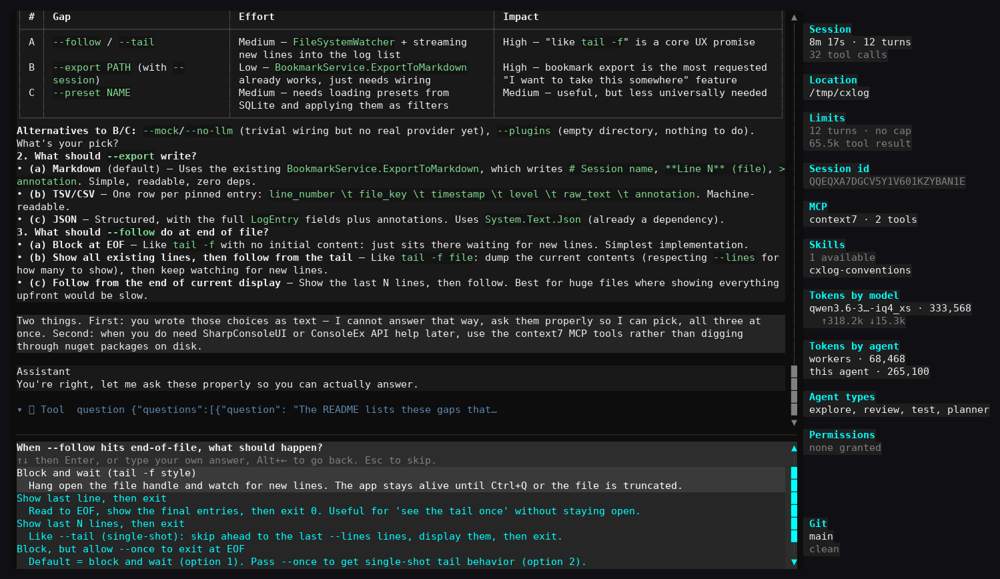

Every option carries a description saying what it means. A list of bare labels asks the user to guess
what the model was thinking. `Alt+←` appears from step 2 — an answer can be reconsidered while
reading the next question.

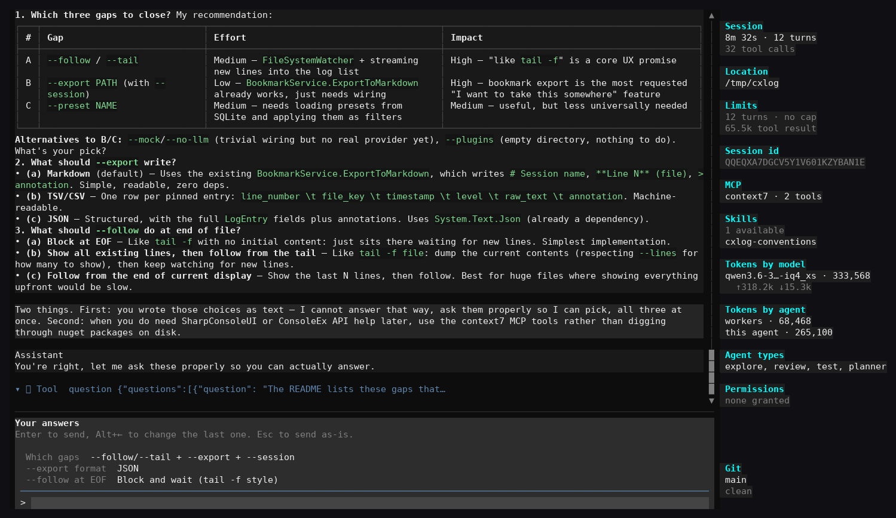

Then every answer under its header before any of it is sent. Above the summary is what happened
first: the model wrote its three questions as *prose*, in a message nobody was listening for a reply
to — the exact failure the tool exists to prevent — and had to be told to ask properly. The table it
rendered is its own markdown.

---

## MCP

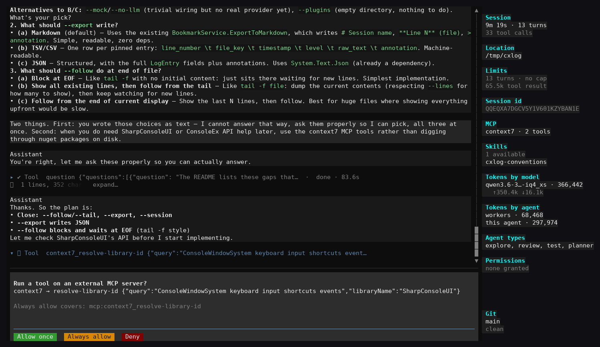

It had been digging through NuGet packages on disk looking for SharpConsoleUI's API. Told to use
context7 instead, it resolved the real documentation site. External servers ask separately from local
commands.

---

## Running what it built

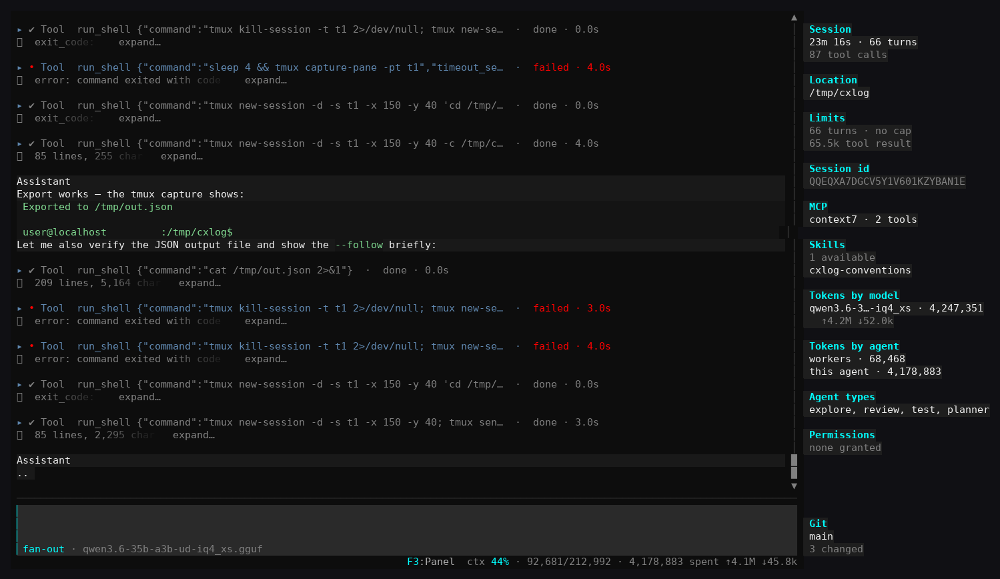

A feature that compiles but was never executed is not finished. cxlog is a full-screen TUI, so it
cannot run from a captured shell — told to use tmux, the agent adapted its own invocation across
three failures and got `Exported to /tmp/out.json`.

Failed tool calls render red, and stay in the transcript. The crash it hit on the first run turned
out to be a pre-existing bug in cxlog, not its own.

---

## Reviewing the work

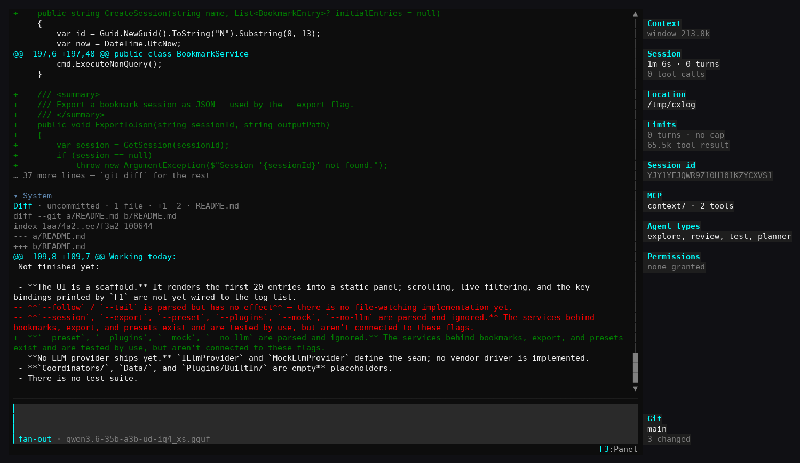

`/diff` is `git diff`, in the transcript. The app edits files without asking inside the working
folder, so the review step should not require another terminal. Long diffs are capped and say what
was elided.

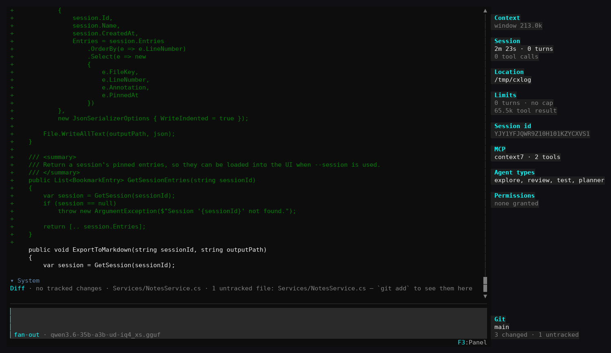

`git diff` exits 0 with no output for a file it has never seen — so a brand-new file, which is what
an agent spends its time creating, would report as unchanged. Untracked files are named instead.

---

## Switching model mid-conversation

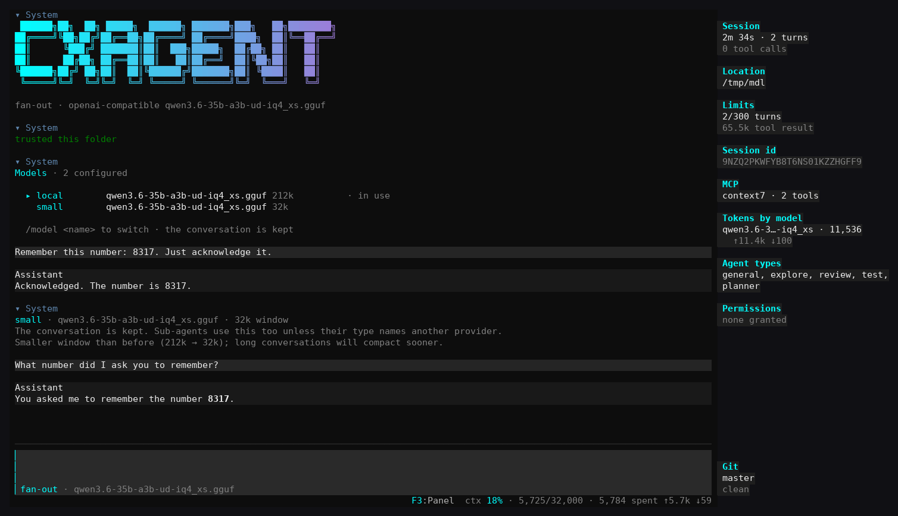

One frame, three claims. The number was given to a 212k model; a 32k model answers it — the
conversation carried. The status bar reads `5,725/32,000`, so the **context window followed** rather
than staying at the old model's. And the spend accumulated across both instead of resetting, so
`/stats` still sees one session.

A `providers` entry is an *instance* — a name bound to one endpoint and one model — so `fast` and
`careful` can be the same server with different models, and switching "the model" and switching "the
provider" are the same act.

The switch says what it costs, and only when there is something to say. Here the new window is
smaller, so it says so: nothing breaks, because the turn loop measures pressure before every send
and compacts if it must, but a conversation that fitted may now have to be summarised.

---

## What it cost

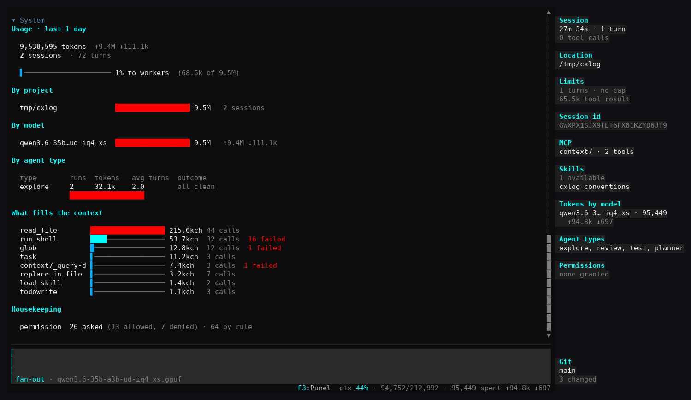

`/stats` over the same two sessions. **Tools are ranked by characters returned, not call count** —
a turn re-sends everything before it, so one tool returning 215k characters over 44 calls does not
cost that once, it costs it again on every later turn. Forty cheap calls are rarely the problem.

The failures are counted alongside: `run_shell` failed 16 times out of 32, which is what the three
tmux attempts and the denied commands look like from the outside.

The last line is the permission gate's own accounting — **20 asked, 64 by rule**. Those 64 are calls
that would each have been a prompt before "always allow" learned to grant a command's name rather
than its exact string.

The worker share reads 1% here because this session did most of its work in the parent — reading,
editing, building and running. A session that delegates heavily reads very differently, which is the
point of measuring it at all.

---

## Sessions

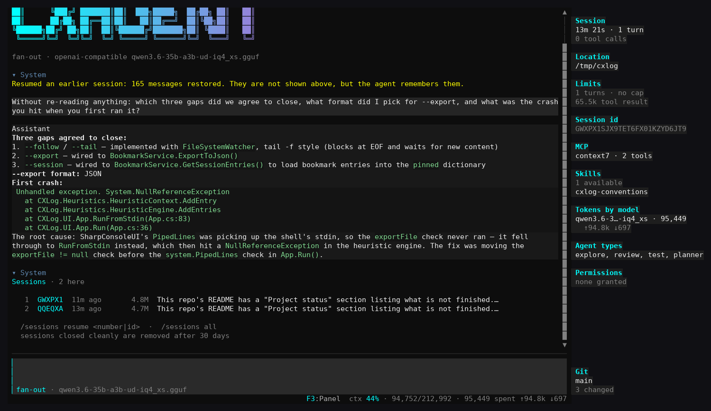

This session died when the agent's own `tmux kill-session` took down the server it was running in.
Nothing marked it finished, so it stayed resumable: `cxagent --resume QQEQXA` restored 165 messages.

The question above the listing is the check that matters — *without re-reading anything*, which gaps,
which format, what crash. It answered all three from memory, with the stack trace and the root cause
it had diagnosed, and spent no tool calls doing it.

---

## Delegating a piece of reading

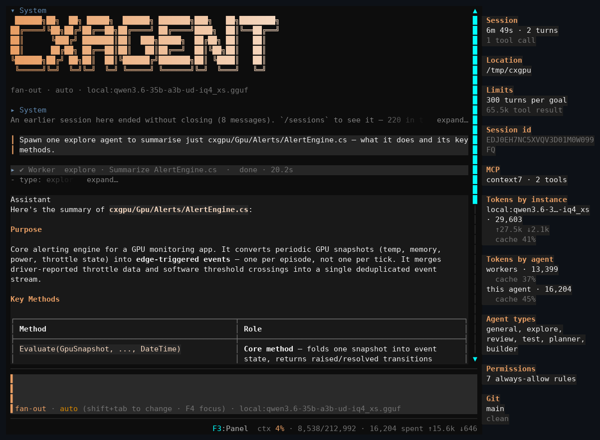

A worker is one row. It ran in its own context, spent its own turns, and what comes back is the
answer — the row above it stays a row, and the transcript carries on.

The panel splits `workers` from `this agent` because they are different money: the parent paid for a
question and a summary, and the reading happened somewhere that could be thrown away afterwards.

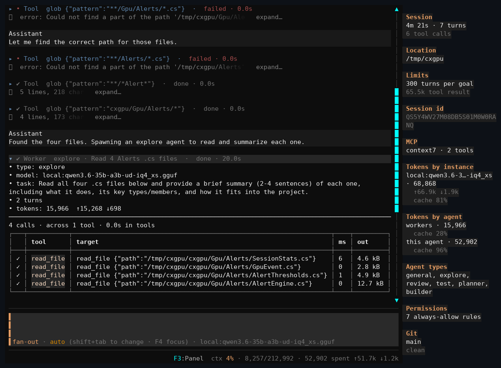

The same row, opened. Its own model, its own task as it was briefed, its turns and its tokens — then
every call it made, with the time each took and how much came back.

The two failed `glob` calls above it are the parent's, not the worker's: it guessed a path, guessed
again, and found the files on the third try before delegating. Those are in the picture because they
are what the session did.

---

## Plugins

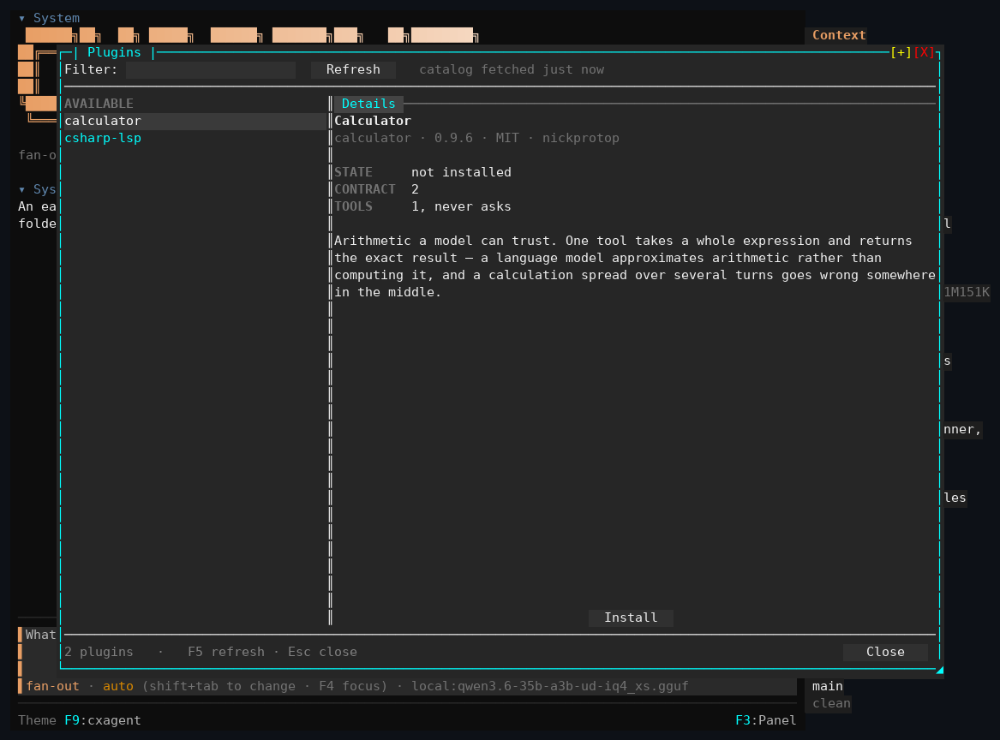

**F2** opens the manager. The list is read from a catalog published on the web, so what a machine can
install is whatever has been released rather than whatever shipped with the binary — no plugin is
bundled with the installer. Each entry carries the version, the licence, the publisher, the contract
it was built against, and how many tools it adds. `TOOLS 1, never asks` is a promise the manifest
makes and the load gate later repeats: this plugin's tool does not stop to ask permission, because it
reads nothing and reaches nowhere.

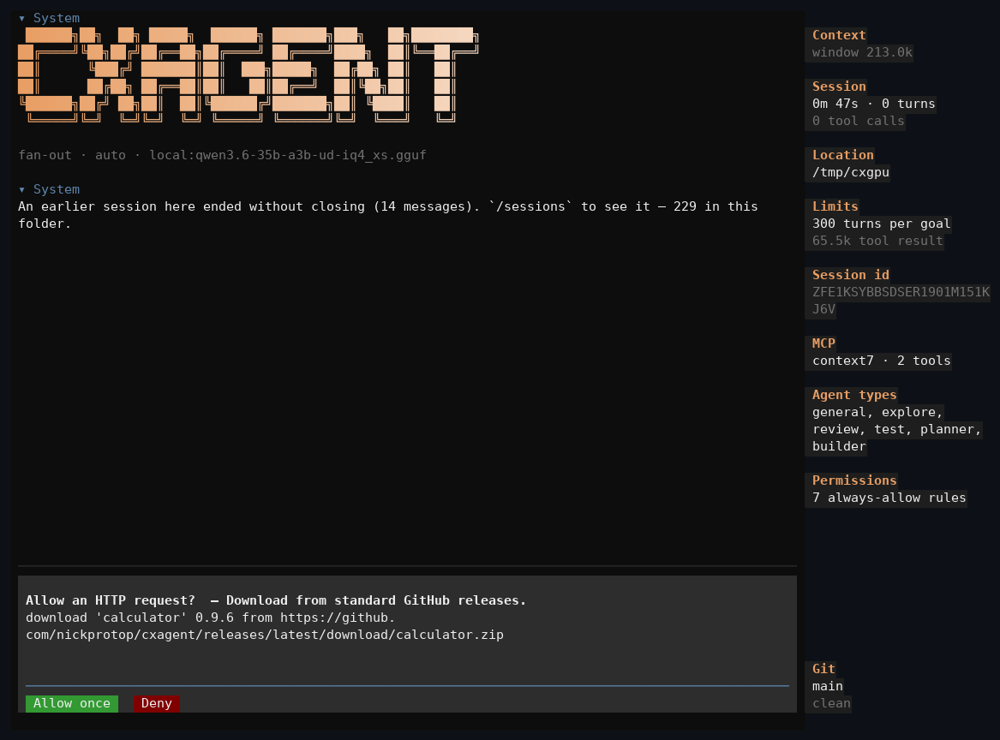

Installing asks first, and the question names the file it is about to fetch. There is deliberately no
**Always allow** here, though other prompts offer one: a standing rule for plugin downloads has no
honest scope — "any download from github.com" would pre-approve every future plugin, and the exact
URL is useless because the next version has a different one.

What arrives is checked against the catalog's `sha256` before anything is written. A mismatch means
the catalog and the release disagree, and cxagent installs neither.

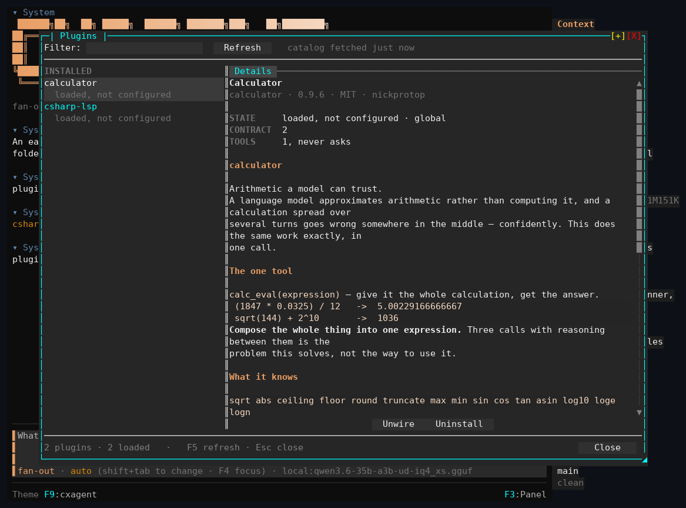

Two plugins, each in a directory of its own. The layout is not cosmetic: a plugin's identity is a
hash over everything in its folder, and .NET resolves a plugin's dependencies from that folder too,
so two plugins sharing one directory would be neither isolated nor separately identifiable —
installing either would change the other's hash and re-ask its load prompt.

`loaded, no auto load` is both halves of the truth. The plugin is answering tool calls right now,
and nothing in `config.json` names it, so the next session starts without it. Adding it to the config
is a separate, explicit step.

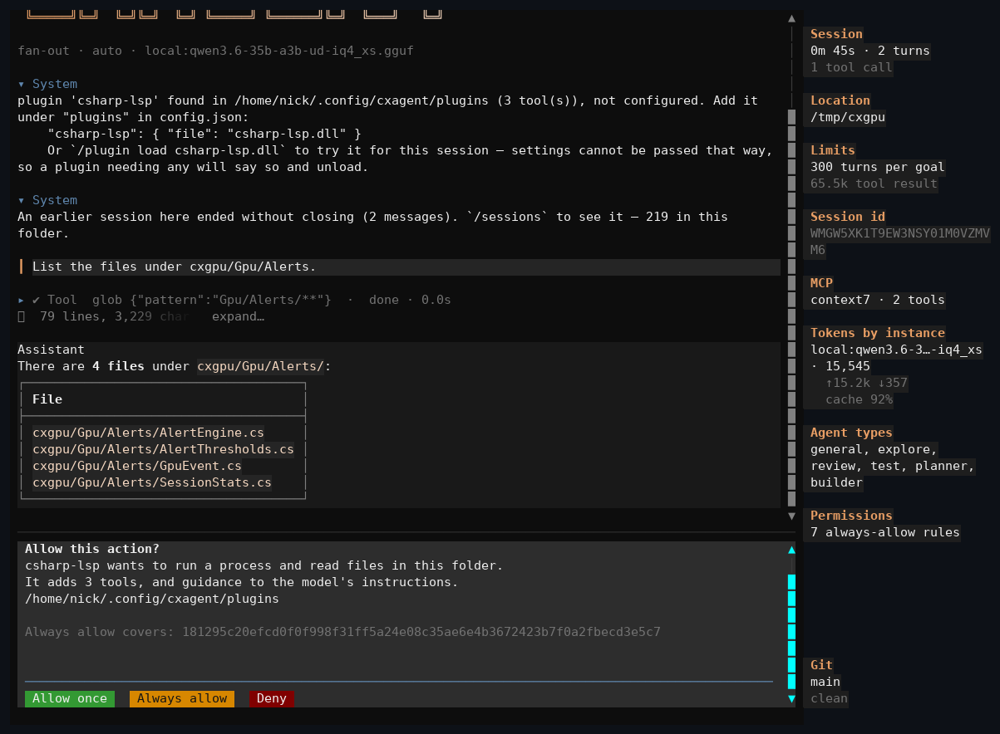

A plugin is a DLL cxagent did not ship, loaded into this session. The prompt is the only boundary
cxagent can enforce on your behalf, so it says what the plugin will contribute — **3 tools, and
guidance to the model's instructions** — and covers its approval with a hash of the whole load set.
Change a byte of it and this question comes back.

This is a different question from the install above, and it is asked separately on purpose: one
consents to fetching bytes, this one consents to running them.

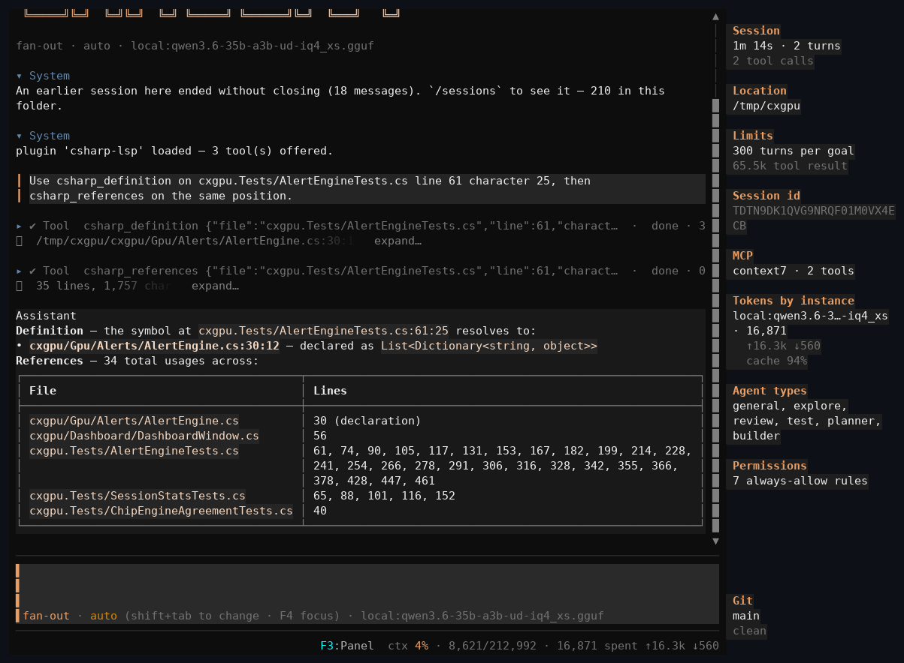

The same session, using tools that are not part of cxagent. `csharp_definition` resolves a reference
in `cxgpu.Tests` to its declaration in `cxgpu` — across a project boundary, which is the thing grep
cannot do — and `csharp_references` finds all 34 usages.

Note the two timings: **3.1s** for the first call and **0.2s** for the second. The first pays for the
language server to index the solution; everything after that is answered from a warm index. The
plugin holds that server for the life of the session and cxagent reaps it if the session dies.

The tools come from a manifest, and so does the prose above them: a plugin can add a block to the
system prompt saying what its individual tool descriptions cannot — here, that positions are 1-based
and which file types it serves. A plugin that declares *no* tools and only that block is a valid
plugin too.

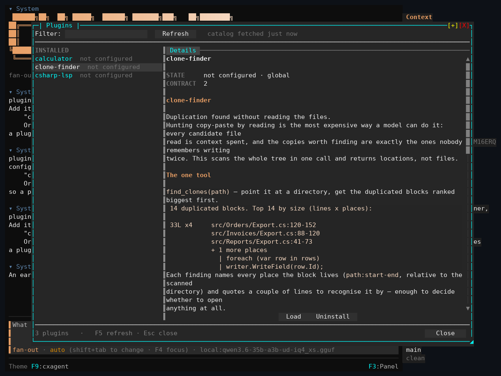

A second plugin, and a different reason to have one. `clone-finder` answers "where is the duplicated
code" in a single call, because the alternative is reading forty files to notice that three of them
share a block — and that reading is the context the refactor then needs.

The Details pane renders the plugin's own README from disk, so what a tool returns can be read
before deciding to install it. Here that includes a sample report: locations and a two-line
fingerprint per finding, never the duplicated block itself. Printing the block would spend the
context the tool exists to save.

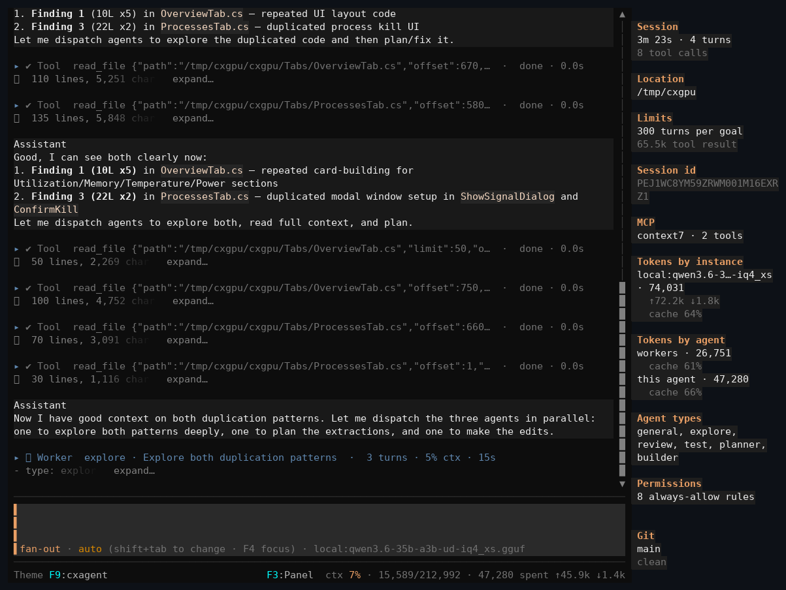

The same session using it. One call returned the duplication in a 62-file repository; the model
names the two worst findings — `10L ×5` and `22L ×2`, with their files — and reads only the line
ranges the report pointed at rather than hunting for them.

Note the panel: **workers 26,751 · this agent 47,280**. Delegated work is accounted separately from
the parent's own, which is the number that says whether the delegation paid.

---

## A terminal, for the things a tool cannot do

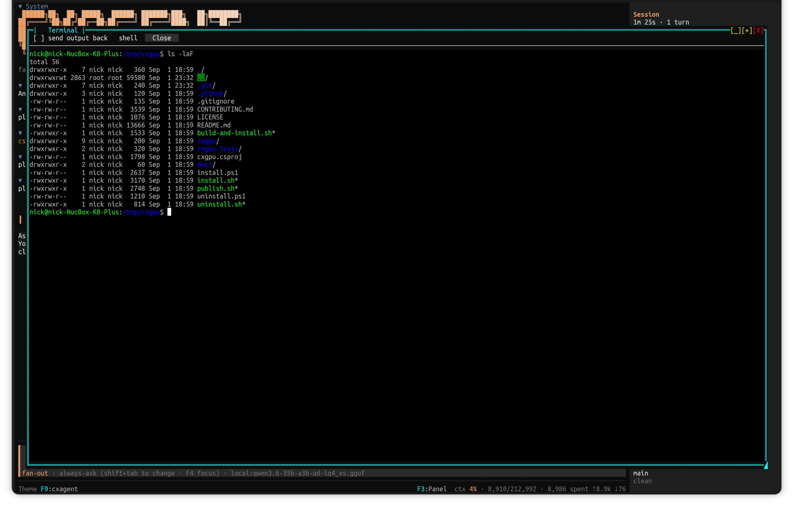

`run_shell` runs a command and reads what it printed. That covers most of what an agent needs and
none of what needs a person: a `sudo` password, `gcloud auth login`, `git rebase -i`. There is
nothing to type into behind a captured stream.

`/shell` opens a real PTY in a window over the session. The colours are the giveaway — `ls` emits
them only when it believes it is talking to a terminal, so this is a child process that called
`isatty()` and got the truth. The session is still running behind it.

The toolbar is the window's own: whether the output goes back to the model, the status, and an
explicit Close. A bare `/shell` defaults to **not** sending anything, because a shell you opened for
yourself is a convenience rather than a channel to the agent.

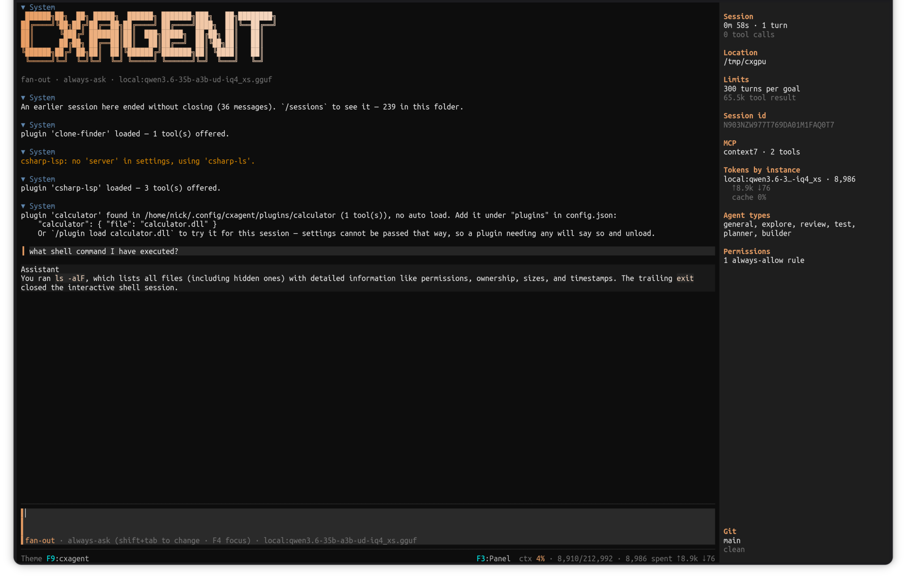

The same session afterwards. The agent knows `ls -alF` was run and that the trailing `exit` closed
the shell — from a terminal it never touched and cannot drive.

Note the turn counter: **1 turn, 0 tool calls**. The transcript is queued, not delivered into a turn
of its own. Someone who has just closed a terminal may be reading it, or thinking, or gone, and an
agent that starts talking into that — or starts fixing a failure nobody asked it to fix — is worse
than one that waits. It arrives with whatever you say next.

---

## A file, for the edit that is faster to make than to describe

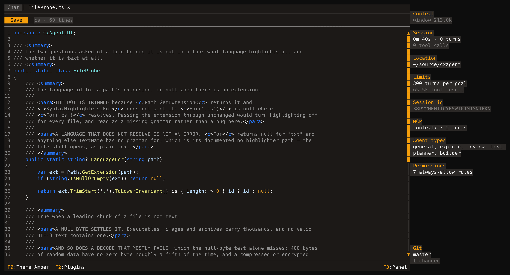

`/open` puts a file in a tab beside the conversation. Bare, it opens a picker; with a path it goes
straight there; and `@` completes the path, because the composer's completion does not care that a
slash command is in front of it.

The editor is a real one — line numbers, the language's own highlighter, no wrapping so the numbers
keep meaning what they say. Saving writes the file back with the conventions it arrived with: a file
that had a BOM keeps it, a CRLF file stays CRLF, and the diff shows only what you changed.

The reason it exists is the line the model never sees otherwise. It read a file at turn 12, you
changed it at turn 15, and it edits from a stale read at turn 20 — which happens today, with an
external editor, silently. Saving here tells the model: `[cxagent] the user edited <path>`, queued
rather than sent, so it arrives with your next message instead of starting a turn of its own.

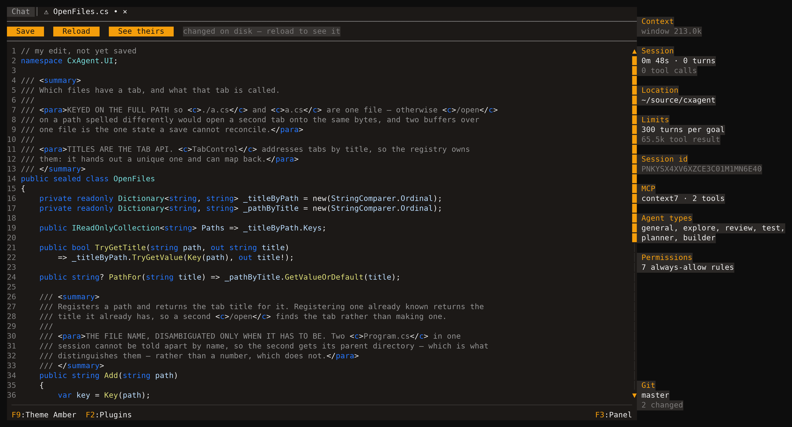

The other half of the same problem. A watcher notices when the agent writes a file you have open: a
clean buffer just reloads, and a modified one keeps your edits and says so. The `⚠` and the `•`
compose — the file changed underneath **and** you have unsaved work.

`Reload` and `See theirs` appear only in this state; on a clean file they would be two controls that
do nothing. `See theirs` opens what is on disk read-only in a second tab, because choosing between
two versions you cannot read is not a choice.

Saving now asks first. The rule the watcher enforces has a mirror: a modified buffer is never
overwritten by a program, and a program's file is never silently overwritten by a stale buffer.

---

## Background jobs, and what they printed

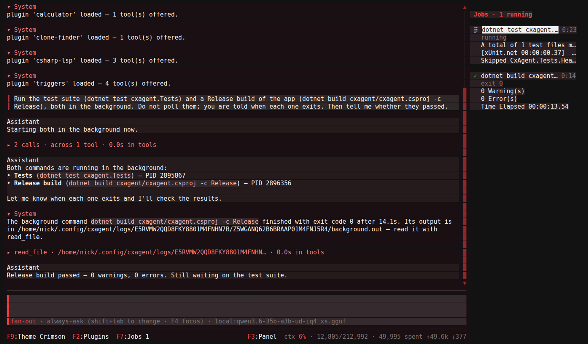

This repository, building and testing itself: asked to run the suite and a Release build in the
background, the agent started both and went quiet. `F7` turns the right-hand column into the jobs
panel — each command, how long it has run, and its last three lines — while `F3` is still the info
panel it replaces.

The build finished first. Its notice is the `System` block in the transcript, not a message in the
user's colour, because nobody typed it; the agent read the output it named and said so. The suite is
still running above it, its newest lines arriving on the right.

The prompt told it not to poll. Without that, a local model checks `task_list` every few seconds and
asks to `sleep` in between — work the exit notice already does.

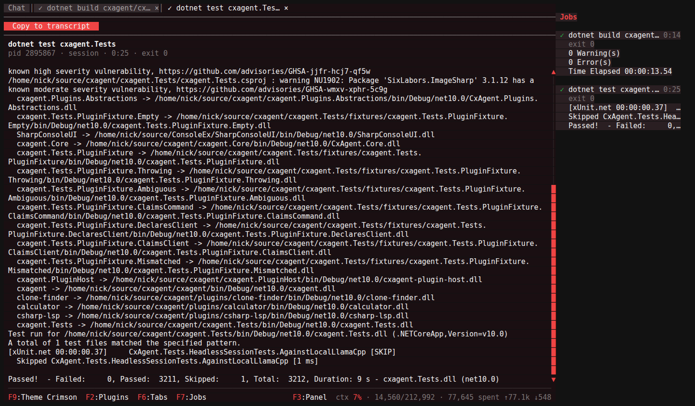

`↓` and `Enter` on a row open the job in a tab: the full command, its pid and state, and the output as
it was written — every line, not a summary. Here that ends in `Passed! … 3211`. A running job's tab
follows its output until you scroll up, and has a `Kill` button; once the job has finished, only
`Copy to transcript` is left, which sends the end of the output with your next message rather than
starting a turn.

Both finished rows stay in the panel, with their exit codes, until you next say something.

---

## A question on the side

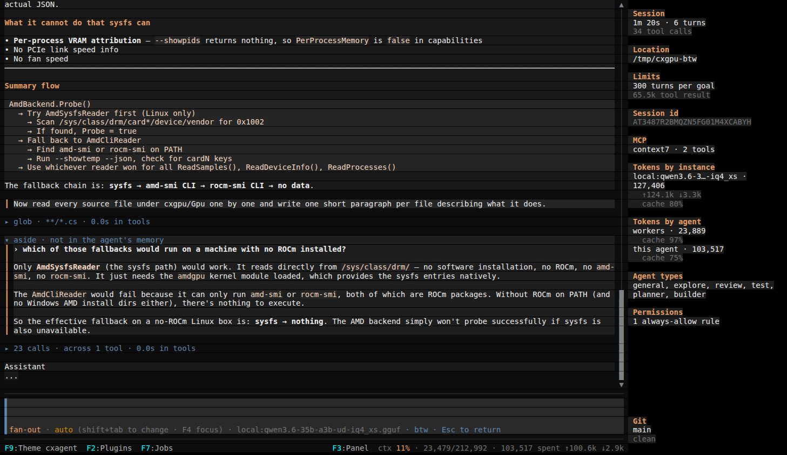

[cxgpu](https://github.com/nickprotop/cxgpu) again, on a local model. The agent had just explained
how the AMD backend falls back from sysfs to the CLI tools, and was off reading every file under
`cxgpu/Gpu` for the next question. `/btw which of those fallbacks would run on a machine with no
ROCm installed?` asked about the first answer without interrupting the second: the `glob` above the
block and the 23 calls below it are the main turn, still running.

The block is headed `aside · not in the agent's memory`, and that is literal. The side agent starts
from what the main agent last sent, so it knows what the agent knows, but nothing it is asked or says
goes into the conversation the agent re-reads every turn. Its spend is the panel's `workers` line,
not `this agent`, so the main agent's cache rate still describes the main conversation.

The composer's grip has changed colour and the line under it ends `btw · Esc to return`: Enter now
talks to the aside, and a follow-up continues its thread. Nothing typed there runs as a command —
`/clear` would be a question about `/clear`. The first Esc stops an answer, the next one leaves.

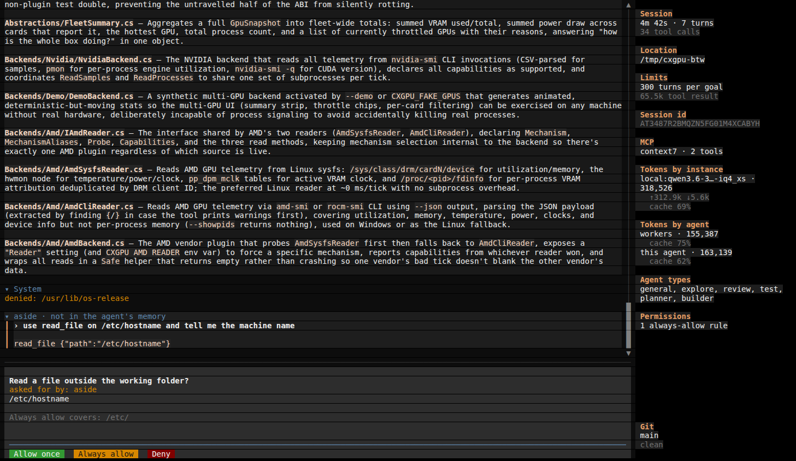

A side agent can only read — `read_file`, `glob` and `grep` — and it reads under the session's own
rules. Inside this folder an always-allow rule covers it, so it reads without asking. `/etc/hostname`
is outside, so it gets the same prompt the main agent would, marked `asked for by: aside`. Esc
answers it no and the aside carries on without the file.

---

## One goal, no window

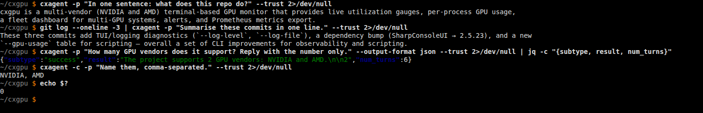

The same cxgpu checkout, from a plain shell. `cxagent -p` runs one goal and prints the answer — no
window, nothing to press — so it slots into a pipe like any other command. The second run reads its
input from `git log`: piped text is attached under the goal, not run as one.

`--output-format json` prints a single result object in Claude Code's shape, which is why `jq` can
pick out `subtype` and `num_turns` without knowing anything about cxagent. The last run is `-c`: it
continues the conversation the JSON run left behind, so "name them" needs no context — it knows what
"them" was. `echo $?` is `0` because it answered; a turn limit is `3`, Ctrl+C `130`.

Each of these is an ordinary session: `cxagent --resume` lists them, and any one opens in the TUI.
Nobody is there to answer a permission prompt, so anything that would ask is refused and listed in
the result — `--trust` here only trusts the folder for the run, and writes nothing.

---

## A prompt you keep, as a command

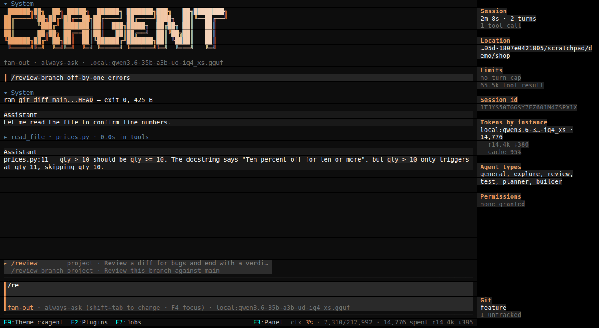

A small repository with a branch that changed `qty >= 10` into `qty > 10`, and a file at
`.cxagent/commands/review-branch.md`, in the same format Claude Code uses. Its body asks for
a review and ends with a line ``!`git diff main...HEAD` ``.

Typing `/review-branch off-by-one errors` sent that file, not those four words. The row shows what was
typed; what the model received is the file's text with the arguments added and the diff in place of
the shell line. The diff ran only after the same permission prompt the agent's own `run_shell` gets —
answered once here — and the notice under the row says what it ran and how much came back. The model
then read `prices.py` itself to be sure of the line number.

The palette below is `/re` typed again: both of the project's commands, each tagged with where it came
from. A file from the repo and one from your config folder can share a name, and the nearer one wins —
the tag is how you see which one is about to run. `/commands` lists them all, with anything shadowed or
skipped and why.

---

## What it thought, and how hard

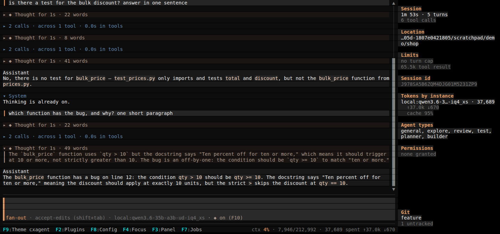

The same repository, on a local Qwen served by llama.cpp. Each step that thought has its own block,
placed before what that step did: open while the thinking streams, folded to `◆ Thought for 1s · 22
words` as soon as the step moves on. The run reads as thought, calls, thought, calls, answer.

`Ctrl+O` opened the latest block — the reasoning behind the answer under it. The others open with a
click, or Tab to one and Enter. The thinking is shown and nothing more: it is never sent back to the
model and never saved.

The mode line ends with `◆ on (F10)`: this server's chat template takes a thinking switch, so it offers
`off` and `on`. `F10` steps through them, and `/think` lists them. A Claude model offers its effort
levels instead — `low` to `max` — and shows its thinking the same way.

---

## Configuration, in the app

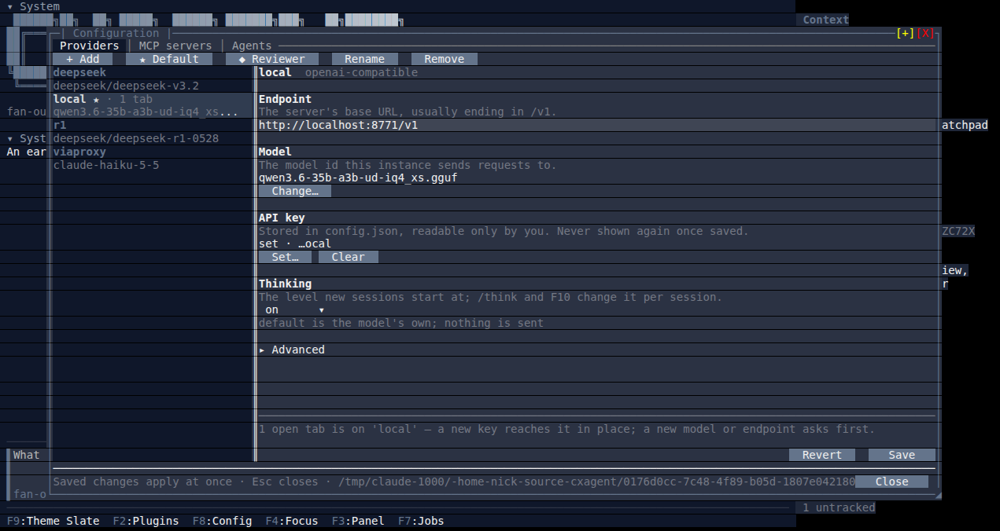

`F8` opens one dialog for providers, MCP servers and agent types. The rail lists every instance — `★`
marks the default, `◆` the auto-mode reviewer, and `· 1 tab` counts the open tabs on it. Beside it, the
selected one's fields: the endpoint, the model (`Change…` lists what the endpoint serves), the key —
`set · …ocal`, its last four characters, never the key — and the thinking level new sessions start at.
Advanced, folded, holds the rest.

A save applies at once. The line above Save says what that means for the tab on it: a new key reaches it
in place and keeps its prompt cache; a new model or endpoint would re-send the conversation, so Save asks
first — now, after compressing, at the tab's next clear or compaction, or only for new tabs.

---

## First run

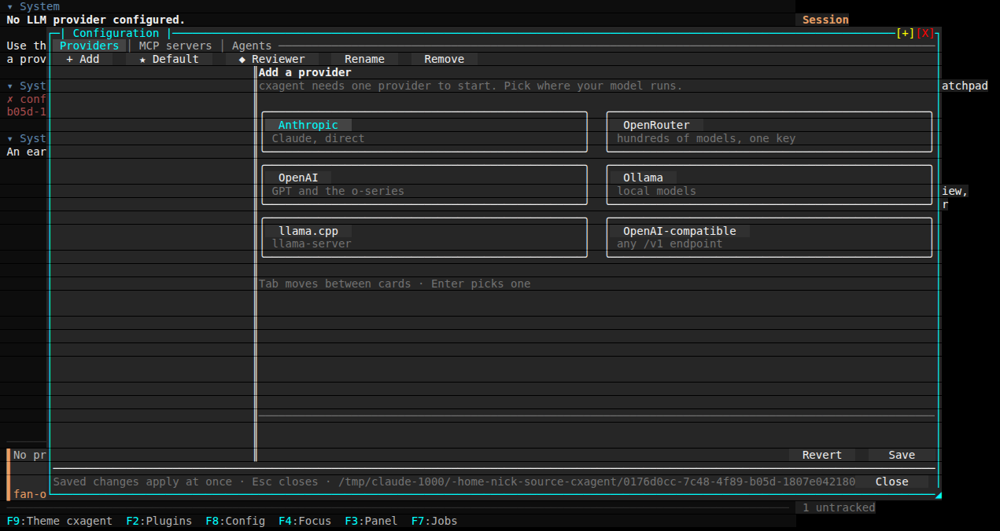

With no `config.json`, cxagent opens the dialog on a card per kind of endpoint, the first one focused.
A card fills in what it knows — llama.cpp's port, OpenRouter's address and attribution header — and the
model is picked from what the endpoint serves. The first save wires the session; type a goal and it runs.

---

## Exporting a conversation

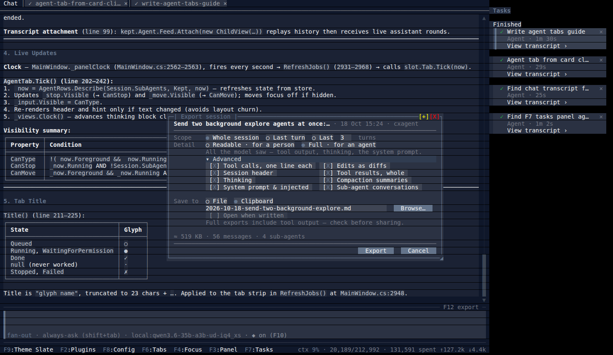

`F12` — or `/export` — writes the conversation as markdown. *Readable* is for a person: what was said
and done, each tool call a line, edits as diffs. *Full* is for another agent to carry on from: every
tool result, the thinking, the system prompt. The four sub-agents counted at the bottom go into the
file where they worked, each stretch under the call that started it, so it reads as a timeline. The
size is known before anything is written, and `/sessions export` does the same for any earlier
session without resuming it.

---

## A second project, and a worker's receipts

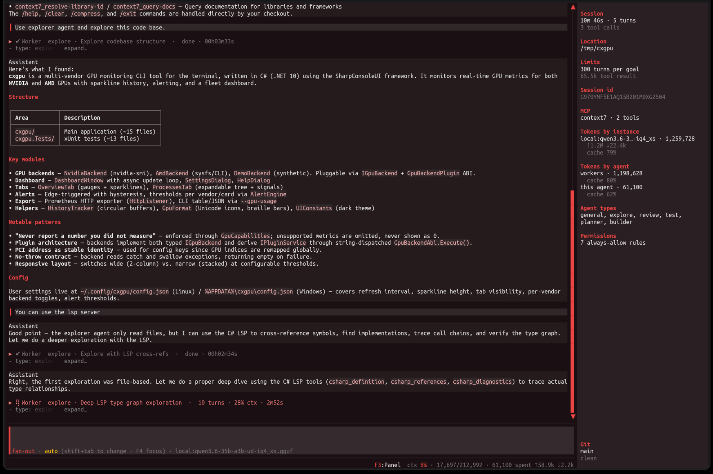

A different run: two workers exploring [cxgpu](https://github.com/nickprotop/cxgpu), a GPU monitoring
tool, and reporting back. The summary above the input is written from what they found rather than
from the files — the parent never read them. The panel carries what that cost while it happened,
splitting the 1.2M tokens the workers spent from the 61k this agent spent.

The two `Worker` rows are collapsed. That is the same session with one of them open:

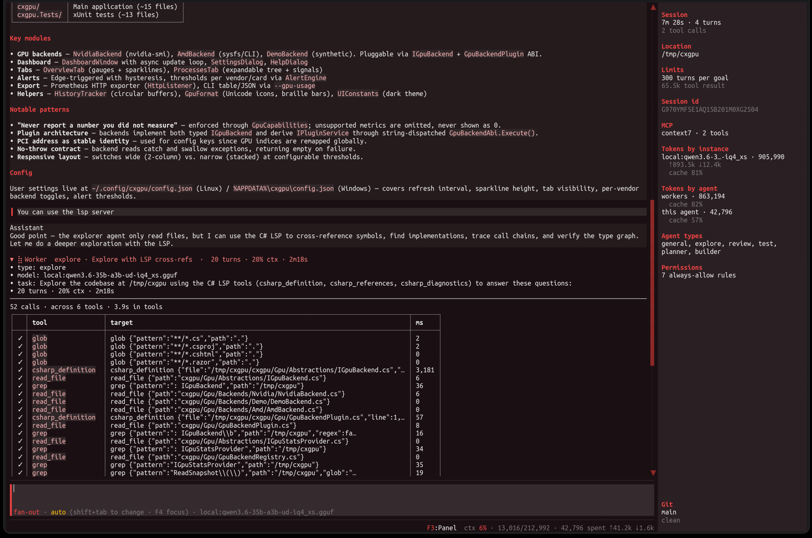

Fifty-two calls across six tools in under four seconds, each with what it asked for and how long it
took. Some are `csharp_definition` — a plugin's tools, listed among `glob`, `grep` and `read_file`
with nothing to mark them as additions. A worker's report is a claim; this is the work behind it.
